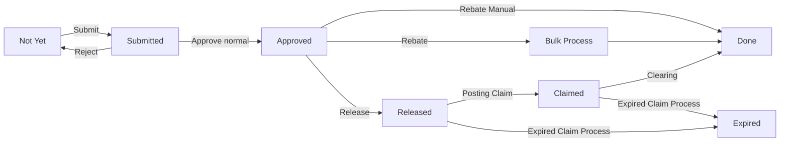

# PRD — Resource Collection Next Gen

Versi 1.1 • 24 September 2026 • Pemilik produk: Daniel • Status: spesifikasi kerja berdasarkan kode, database, keputusan pemilik, dan audit saat ini.

Dokumen ini membedakan **aturan aktif**, **implementasi yang sudah diuji**, dan **target berikutnya**. Target kapasitas maupun SLA bukan hasil pengukuran. Bukti implementasi terbaru ada pada [laporan audit](audit/application-2026-09-22.md); dokumen September sebelumnya merupakan riwayat, bukan gambaran lengkap versi terbaru.

Perubahan terbaru, People Performance, seluruh izin tab, diagram, batas upload, dan acceptance criteria rinci tercantum pada [spesifikasi 23-24 September](rc-release-2026-09-24.md), yang menggantikan aturan lama bila berbeda.

Aturan nominal: kartu ringkasan report memakai satuan **jt**; Details dan ekspor tetap memakai rupiah penuh tanpa pecahan rupiah. Persentase serta jumlah dokumen tetap memakai satuannya sendiri.

## 1. Masalah, tujuan, dan ukuran keberhasilan

Resource Collection mengelola klaim cashback depot, mulai dari data sumber, kelengkapan pengajuan, persetujuan, release, penagihan ke Finance, sampai clearing dan laporan. Sistem legacy menggunakan Spreadsheet/Apps Script, identitas yang diteruskan browser, pengambilan dataset besar, dan sinkronisasi Document Center terpisah. Migrasi memindahkan otorisasi dan transaksi ke Supabase, dengan frontend statis di Vercel.

Tujuan produk:

1. Menjamin status klaim mencerminkan keputusan yang benar-benar disetujui.
2. Menjamin setiap pengguna hanya mengakses depot dan modul dalam kewenangannya.
3. Menghilangkan akun setengah terbentuk: Auth, profil, yurisdiksi, dan audit harus konsisten.
4. Mempertahankan tampilan, navigasi, format identitas, dan hasil bisnis yang telah disepakati.
5. Menyediakan laporan yang bisa ditelusuri ke data dan definisi perhitungan yang sama.
6. Menyiapkan pertumbuhan melalui pagination/agregasi di server dan pengujian staging.

| Indikator | Kriteria penerimaan |
|---|---|
| Registrasi valid | Akun muncul setelah refresh server; role, depot/OSC/region sama dengan pilihan yang disimpan |
| Registrasi gagal | Tidak meninggalkan akun aktif, grant, atau ledger parsial |
| Retry transaksi | Request ID yang sama tidak menghasilkan transaksi/akun kedua |
| Status sebelum approval | Submit baru menjadi Submitted sampai approval; blank ditampilkan sebagai Not Yet |
| Claim Process Expired | Efektif langsung pada transisi yang diizinkan dan tidak masuk antrean approval |
| Hak akses | Permintaan lintas depot dan eskalasi role ditolak server |
| Audit | Aktor berasal dari JWT; keputusan dan waktu dapat ditelusuri |
| Mutu data | Temuan memiliki jumlah, definisi query, pemilik tindak lanjut, dan bukti penyelesaian |
| Kapasitas | Diterima hanya setelah pengukuran staging, bukan berdasarkan halaman masih terbuka |

## 2. Cakupan dan batas

### 2.1 Cakupan aktif

Auth dan sesi; registrasi mandiri dan registrasi oleh pengelola; Access Management; Claim Upload; Management of Approval; Release Doc; Claim Process; Bulk Process/Rebate; Key Master customer/campaign/depot; Analytics; Report dan dashboard publik; Timetable; perubahan profil depot; Log Activity; integrasi email yang sudah ada; pengarsipan/reprocessing dan fungsi Compile RC yang terdapat pada source saat ini.

Pengembangan dan perbaikan mempertahankan struktur UI. Penyesuaian pilihan role, validasi, notifikasi, dan perilaku tombol diperbolehkan untuk menyelaraskan UI dengan backend.

### 2.2 Ditunda

Migrasi penuh backend **Document Center legacy**, parser/sumber Upload_CB legacy, Print Document, pemindahan trigger sinkronisasi 15 menit, dan cutover alur dokumen baru lintas sistem. Adanya kode Compilation RC tidak membuktikan integrasi Document Center selesai. Tidak boleh menonaktifkan job legacy tanpa inventaris, rekonsiliasi, dan rencana cutover yang disepakati.

Staging terpisah belum tersedia. Pengujian 1.000.000 klaim dan hingga 1.500 concurrent users tetap pekerjaan berikutnya; project yang telah dipakai depot tidak boleh dijadikan target stress test.

## 3. Pengguna, peran, dan yurisdiksi

Role menentukan cara menghitung yurisdiksi. Permission modul menentukan tindakan. Menyembunyikan tombol hanya membantu pengguna; otorisasi selalu diperiksa server.

| Role kanonis | Label | Sumber depot efektif | Access Management |
|---|---|---|---|
| `admin` | Admin Depot | Grant depot RP | Viewer bila memiliki akses modul |
| `osc` | OSC | Depot assigned | Viewer bila memiliki akses modul |
| `others` | Non-OSC | Depot assigned; departemen terpisah | Viewer bila memiliki akses modul |
| `finance` | Finance | Depot assigned | Viewer bila memiliki akses modul |
| `depot head` | Depot Head | Depot assigned; hak modul melekat pada role | Viewer |
| `management` | Management | Area depot langsung dan/atau region terpilih; hak modul melekat | Viewer |
| `supervisor` | Supervisor | Area depot langsung dan/atau gabungan depot OSC binaan | Mengelola akun dalam kewenangannya |
| `system manager` | System Manager | Seluruh depot | Mengelola keseluruhan; membuat System Manager |

Ketentuan:

- Hanya Supervisor dan System Manager boleh mengubah Access Management. Role lain tetap dapat membaca sesuai scope dan izin.
- Supervisor tidak boleh mengelola System Manager, memilih depot/OSC di luar kewenangan, atau mengambil region yang sebagian depotnya berada di luar kewenangan.
- Depot asal adalah identitas organisasi; depot efektif adalah izin baca/tulis. Keduanya tidak boleh disamakan secara diam-diam.
- Perubahan role membersihkan mapping yang tidak lagi sesuai dan membangun ulang akses efektif.
- Mengubah identitas saja tidak boleh menonaktifkan akun atau menghapus permission yang tidak dikirim.
- Departemen seperti Finance/Sales tidak menggantikan kode role Non-OSC.
- Akun Pending, Rejected, nonaktif, deleted, atau wajib ganti PIN tidak boleh mengakses operasi bisnis yang membutuhkan akun aktif.
- Penghapusan akun dibatasi System Manager, bukan akun sendiri, dengan alasan dan pemeliharaan referensi histori.

## 4. Perjalanan pengguna

### 4.1 Pendaftaran mandiri

Pengguna mengisi User ID, nama, email korespondensi, PIN, role yang diminta, dan depot. Auth membuat profil Pending. UI menyatakan bahwa persetujuan diperlukan. Pengelola dalam scope meninjau permohonan; approve mengaktifkan profil dan menetapkan depot asal. Role berbasis depot mendapat mapping depot yang disetujui. Supervisor/Management memerlukan konfigurasi OSC/region lanjutan melalui Edit Akses. Permission tidak boleh diberikan berdasarkan input pengguna sendiri. Permintaan System Manager tidak boleh otomatis menjadi hak global.

### 4.2 Registrasi oleh pengelola

Pengelola membuka Registrasi, menerima pilihan role/depot dari server, mengisi identitas dan mapping, lalu menekan Buat Akun. Selama request berjalan tombol ditahan. Edge memverifikasi JWT, database memvalidasi kewenangan, kemudian Auth membuat akun. Trigger menyelesaikan profil aktif, suffix, mapping, dan audit dalam transaksi Auth. Pengelola melihat akun baru setelah refresh daftar dan melengkapi permission melalui Edit Akses. Akun baru wajib mengganti PIN awal sebelum bekerja.

### 4.2.1 Upload user oleh pengelola

Template hanya berisi User ID, Nama Lengkap, Kode Depot, Email, Role, PIN, dan Resource Partner / Area. Area diisi kode depot, dipisahkan koma jika lebih dari satu. Semua upload masuk Pending dan Approval Request; tidak ada grant efektif sebelum approval. Reviewer memeriksa seluruh area, kemudian approve mengaktifkan role, area, dan suffix otomatis. Reject tetap tidak aktif. Retry tidak membuat duplikat atau mengganti PIN. Lihat [spesifikasi upload user dan bukti pengujian](rc-user-upload-approval.md).

### 4.3 Klaim normal

Admin memilih klaim Not Yet, melengkapi field, menjalankan preview, lalu submit. Sistem menyimpan permohonan dan mengubah status menjadi Submitted. Approver meninjau versi terbaru. Setelah approve, dokumen masuk Release, lalu Claim dan Clearing sesuai permission. Setiap transisi menyimpan aktor, versi, batch bila diperlukan, dan histori.

### 4.4 Pengecualian

Hold/Expired dari Upload mengirim permohonan ke Management of Approval; nilai efektif tidak berubah sebelum keputusan. Expired yang diposting dari Claim Process pada dokumen Released/Claimed berlaku langsung sesuai aturan modul dan tidak memerlukan approval tambahan.

### 4.5 Pemantauan

Pengguna berizin membaca dashboard, laporan, timeline, log, dan outstanding sesuai scope. Dashboard publik menampilkan agregat yang diizinkan tanpa identitas customer, rekening, KTP/NPWP, atau detail akun.

## 5. Persyaratan fungsional dan acceptance criteria

### FR-AUTH — Login, sesi, dan PIN

| ID | Persyaratan | Acceptance criteria |
|---|---|---|
| AUTH-01 | Login User ID + PIN menggunakan Supabase Auth | PIN dikirim utuh termasuk spasi; tidak disimpan di laporan/log/frontend storage |
| AUTH-02 | Kompatibilitas alias legacy | Coba casing input dahulu, lalu uppercase/lowercase hanya pada invalid credentials; hentikan pada rate limit/network error |
| AUTH-03 | Identitas baru kanonis | User ID dipangkas dan uppercase; hanya huruf, angka, titik, underscore, strip; unik |
| AUTH-04 | Sesi per tab | Reload memakai sessionStorage; logout membersihkan sesi dan cache versi dokumen |
| AUTH-05 | Gate PIN awal | Bootstrap bisnis tidak mengembalikan dokumen sebelum PIN diganti; perubahan PIN membersihkan gate |
| AUTH-06 | Status akun | Pending/Rejection/nonaktif memiliki pesan jelas dan tidak diberi data bisnis |
| AUTH-07 | Penggantian/reset PIN | Mengikuti alur request/review yang sudah ada; tidak membuka PIN lama atau mereset diam-diam saat retry |

PIN Registrasi minimal 8 karakter dan maksimal 72 byte UTF-8. Email korespondensi berbeda dari alias login internal. Kasus alias impor yang tidak mengikuti pola casing tetap perlu rekonsiliasi; fallback tidak boleh mengubah kredensial akun nyata.

### FR-ACCESS — Access Management dan Registrasi

| ID | Persyaratan | Acceptance criteria |
|---|---|---|
| ACCESS-01 | Satu katalog role server | Delapan role tersedia untuk SM; opsi SM tidak tersedia untuk Supervisor |
| ACCESS-02 | Pilihan sesuai scope | Depot/OSC/region yang tidak dapat diberikan tidak ditawarkan dan tetap ditolak bila payload dimanipulasi |
| ACCESS-03 | Mapping sesuai role | Depot untuk semua role non-System Manager; Supervisor dapat menambah OSC, Management dapat menambah region |
| ACCESS-04 | Pembuatan atomik | Manual: Auth + profil + mapping + ledger + audit atomik. Upload: profil Pending + proposal atomik; mapping diterapkan saat approval |
| ACCESS-05 | Idempotensi | UUID request sama + payload sama mengembalikan akun yang sama; payload berbeda ditolak |
| ACCESS-06 | Trust boundary | `user_metadata` dari browser tidak bisa mengaktifkan akun; envelope pengelola berasal dari Admin API yang terverifikasi |
| ACCESS-07 | Sinkronisasi tampilan | Sesudah sukses, refresh data server selesai sebelum menampilkan daftar; kegagalan refresh diberi pesan terpisah |
| ACCESS-08 | Respons berurutan | Respons refresh lama tidak boleh menimpa hasil refresh yang lebih baru |
| ACCESS-09 | Edit akses | Permission approval ikut tersimpan; field yang tidak dikirim dipertahankan; perubahan role membersihkan region/mapping lama |
| ACCESS-10 | Viewer | Dapat membuka tab, mencari, dan menyegarkan; create/update/review/delete ditolak server |
| ACCESS-11 | Review registrasi | Hanya satu keputusan atas Pending; reviewer tidak menyetujui diri sendiri; keputusan lintas scope ditolak |
| ACCESS-12 | Keamanan rendering | Nama, departemen, label master, perubahan profil, dan detail log diperlakukan sebagai teks |

Form tetap memakai tata letak yang sama. Suffix dibuat server, bukan input Registrasi. Akun baru selain role dengan hak intrinsik tidak otomatis mendapat seluruh permission modul. Ini harus dijelaskan dalam pesan sukses.

### FR-CLAIM — Upload, preview, dan submit

- Pilihan dokumen mengikuti depot, status, arsip, dan permohonan yang sedang menunggu.
- Preview memvalidasi dokumen unik, versi, field wajib, angka, tanggal, rekening, dan identitas pajak sesuai jenis cashback.
- Nomor rekening, kode customer, KTP/NPWP, dan nomor dokumen adalah teks; leading zero tidak boleh hilang.
- Field Approval tidak lagi berasal dari upload pengguna. Persetujuan dilakukan di Management of Approval.
- Nilai Jenis CB yang diketik pengguna dikirim sebagai override terkontrol; nilai otomatis dapat mengikuti Campaign Master. Alias legacy seperti Voucher dipetakan sesuai aturan yang sudah diimplementasikan.
- Batas Claim Upload adalah 500 toko/baris; compile Document Center maksimal 2.000 baris.
- Tanggal ambigu tidak ditebak. Konversi mengikuti parser dan format yang disepakati; server menerima bentuk kanonis.
- Hasil parsial harus menyebut dokumen berhasil/gagal dan alasan. UI hanya memperbarui dokumen yang benar-benar berhasil.
- Submit baru menambah pending request, versi, dan jejak audit; status menjadi `submitted`. Retry tidak menggandakan transaksi.

Penerimaan: submit satu dan batch, duplikat dalam file, versi usang, field tak dikenal, tanggal tidak sah, leading zero, nilai negatif, dan kegagalan lintas depot harus memiliki hasil eksplisit.

### FR-APPROVAL — Management of Approval

Antrean memisahkan pengajuan normal dan permohonan Hold/Expired. Detail memuat data versi terkini sebelum keputusan. Approve membutuhkan permission `approve_claim`; identitas approver berasal dari JWT. Dokumen yang sudah diputuskan tidak muncul lagi sebagai pending.

| Kejadian | Status sebelum keputusan | Hasil keputusan |
|---|---|---|
| Submit normal | Submitted + pending submit | Approve menjadi Approved; Reject kembali Not Yet dan dapat diajukan ulang |
| Submit Rebate Manual (RA07/RA7) | Submitted + pending submit | Approved kemudian Done; kedua tahap tercatat |
| Hold dari Upload | Status efektif sebelumnya | Hold efektif hanya sesudah approve; reject mempertahankan kondisi sebelumnya |
| Expired dari Upload | Status efektif sebelumnya | Expired efektif hanya sesudah approve |
| Expired dari Claim Process | Released atau Claimed yang valid | Langsung Expired, tanpa permohonan approval |

Blank dan NULL pada tampilan legacy disetarakan dengan Not Yet. `pending_approval` adalah permohonan, bukan status workflow tambahan yang boleh menimpa status efektif.



### FR-WORKFLOW — Release, Claim, Clearing, Bulk Process

Release hanya mengambil dokumen yang sudah memenuhi tahap persetujuan. Claim dan Clearing memeriksa status, permission, depot, versi, dan kelengkapan yang relevan. Reject/unhold/reprocessing menggunakan transisi eksplisit dan alasan; jangan membangun transisi berdasarkan label UI semata. Batch dan timestamp dibuat server.

Bulk Rebate memakai aturan tersendiri; tidak dapat dipakai untuk melewati permohonan approval yang belum selesai. Ekspor setelah posting hanya memasukkan dokumen yang benar-benar sukses. Dua pengguna yang mengubah versi sama tidak boleh menimpa perubahan tanpa pemberitahuan konflik. Request ID berbeda dengan versi lama harus ditolak, bukan diperlakukan sebagai retry sah.

### FR-MASTER — Key Master dan profil depot

Customer menyimpan kode/nama, data pajak, rekening, dan relasi depot. Campaign menyimpan kode/nama, jenis cashback, status pajak, periode, serta metadata relevan. Depot menyimpan kode/nama, alamat, region, dan master link. Import/update menjaga referensi dan tidak mengasumsikan mapping dari pola kode.

Data sensitif hanya dapat dibaca melalui scope/permission yang sesuai. Arsip mempertahankan referensi histori. Perubahan alamat/nama/master link dari alur request depot memerlukan review yang sesuai. Pengguna tidak menyetujui request dirinya sendiri. Data sumber anomali dipertahankan sampai rekonsiliasi dengan bukti; angka, rekening, dan tanggal tidak diisi menggunakan tebakan.

### FR-REPORT — Analytics, Report, dashboard publik, ekspor

- Definisi status, nilai, gross-up, outstanding, aging, dan filter harus sama antara dashboard dalam aplikasi dan publik bila scope/filter sama.
- Report dan dashboard publik memakai komponen bersama untuk mencegah perbedaan rumus/rendering.
- Dashboard publik hanya mengembalikan agregat yang disetujui. URL publik frontend tidak otomatis membuat tabel detail menjadi publik.
- Filter region/depot/campaign dan agregasi dijalankan server; data kosong dibedakan dari error/akses ditolak.
- Report/export memiliki header, filter, tanggal pengambilan dan timezone yang konsisten. Identitas panjang tidak menjadi notasi eksponen. Ekspor CSV menetralkan formula berbahaya.
- Status master terbaru dan snapshot dokumen dibedakan. Untuk field yang bisnisnya mengikuti master terbaru, laporan harus memakai resolver yang sama dengan workflow.

Jalur saat ini mencakup `/report`, `/analytics`, `/dashboard`, `/dashboard/cost-center-1`, dan `/dashboard/cost-center-2`. Respons Vercel yang meminta login adalah proteksi deployment, bukan bukti bahwa Auth aplikasi gagal.

### FR-OPS — Timetable, log, email, arsip, Compile RC

Timetable menampilkan jadwal dan pencapaian menurut depot/region serta permission. Penandaan dan perubahan dicatat. Log mencatat aktor, entitas, jenis kejadian, waktu, dan ringkasan yang aman; log tidak berisi PIN/token. Filter log tidak mengubah otorisasi server.

Email mengikuti konfigurasi/template/outbox yang sudah ada. Sukses enqueue berbeda dari email terkirim; kegagalan dan retry perlu terlihat. Audit tidak mengirim ulang email ke pengguna nyata. Compile RC yang sudah terdapat dalam kode memerlukan preview/commit tervalidasi, duplicate handling, scope, dan pelacakan sumber; fungsi tersebut tidak boleh dianggap sebagai selesainya migrasi Document Center legacy.

## 6. Data, relasi, dan sumber kebenaran

| Entitas | Fungsi dan invariant |
|---|---|
| `auth.users` / `profiles` | Satu identitas Auth dengan satu profil; role/status dikendalikan server |
| `depots` / `user_depot_grants` | Master organisasi dan assignment kanonis |
| `user_supervision` / `user_region_access` | Sumber yurisdiksi Supervisor dan Management |
| `user_depot_access` | Hasil materialisasi scope; harus sama dengan perhitungan sumbernya |
| `permissions` / `user_permissions` | Katalog tindakan dan grant eksplisit; role intrinsik tetap berlaku |
| `customers` / `customer_depots` | Customer dapat terkait beberapa depot; tidak terlihat tanpa mapping yang sah |
| `campaigns` | Aturan campaign dan informasi master yang berlaku |
| `claims` | Dokumen bisnis, referensi master, nilai, versi, status efektif, dan pending approval |
| `claim_status_history` / `activity_logs` | Riwayat transisi dan audit aktor |
| `managed_registrations` | Ledger privat request registrasi; tidak menyimpan password |
| `profile_change_requests` / request depot/PIN | Antrean perubahan dengan pemohon, status, reviewer dan waktu |
| `email_outbox` | Status pengiriman terpisah dari transaksi bisnis |
| Snapshot/staging migration | Bukti sumber dan reject; bukan tabel yang boleh langsung ditulis browser |

Field angka finansial menggunakan tipe numerik di database; browser hanya melakukan konversi yang jelas. Nilai kosong tidak otomatis menjadi nol. Periode berupa tanggal; timestamp transaksi disimpan sebagai timestamp berzona. Tampilan bisnis menggunakan Asia/Jakarta (UTC+7). Dataset audit 22 September: 2.756 klaim, 2.067 customer, 100 campaign, 52 depot, 7 profil (6 aktif).

## 7. Perhitungan bisnis

Rumus aplikasi adalah implementasi keputusan bisnis yang sudah ada, bukan penetapan kebijakan pajak baru. Jenis cashback, subyek pajak, status pajak campaign, periode, dan pilihan override harus memiliki prioritas yang terdokumentasi. Gross-up harus menggunakan resolver yang sama untuk posting dan report; hasil kosong tidak boleh diisi dari kolom yang salah. Rujukan karakterisasi dan koreksi: [audit field upload](rc-audit-field-upload.md).

Acceptance criteria perhitungan mencakup nilai nol, batas bracket, pecahan, pembulatan, badan/pribadi, pajak ditanggung perusahaan/customer, Rebate Non Tax, RA07/RA7, dan alias Voucher. Perubahan formula memerlukan contoh input/output yang disetujui pemilik sebelum mengubah saldo historis. Temuan cashback melebihi net value atau volume sama dengan rupiah adalah sinyal rekonsiliasi, bukan bukti otomatis bahwa transaksi salah.

## 8. Kontrak API dan konsistensi

Frontend `src/parts` + `src/js` dibangun menjadi `public/index.html`; adapter `scripts/rc-legacy-adapter.js` menerjemahkan action UI menjadi RPC/Edge Supabase. `ResourceCollection`, `DocumentCenter`, dan `index (4)/(5).html` menjadi referensi legacy, bukan entrypoint runtime baru.

Upload memakai action=submit_upload dengan request_id, user_code, full_name, business_email, role, home_depot, depot_codes[], dan password. Source upload ditetapkan oleh Edge, tidak mengambil flag aktivasi dari browser. Respons pertama activation=pending.

Kontrak Registrasi manual:

```text
POST /functions/v1/rc-admin + JWT pengguna
action=create, request_id=UUID, user_code, full_name, business_email,
role, department, home_depot, depot_codes[], osc_codes[], regions[], password

200 replay / 201 created:
status=success, id, user_code, message, source, activation

400 input salah; 401 sesi tidak sah; 403 kewenangan;
409 konflik pembuatan; 413 payload terlalu besar; 503 hasil belum terkonfirmasi.
```

Edge memanggil `rc_prepare_registration` sebagai pengguna. Admin API hanya berjalan setelah rencana divalidasi. Supabase Auth dapat menulis app metadata sesudah INSERT; trigger INSERT dan UPDATE metadata sama-sama ditangani. Error tidak boleh dilaporkan sebagai sukses hanya karena objek Auth telah dibuat.

`rc_legacy_manageable` mengembalikan users, depots, profileRequests, canEdit, registrationOptions. `rc_update_access` menegakkan role/mapping dan menjaga field yang tidak dikirim. `rc_process_claims` menerima action, item beserta version, request ID, dan alasan. Server tidak memakai requesterRole/requesterId dari browser sebagai kewenangan.

## 9. Persyaratan nonfungsional

### 9.1 Keamanan dan privasi

RLS aktif untuk tabel publik; anonymous tidak boleh menulis tabel inti. Mutasi klaim melalui RPC terotorisasi. Fungsi security definer memakai search_path tetap dan EXECUTE terbatas. Service role/PAT hanya berada di server/lingkungan kerja, tidak di bundle frontend. Data sensitif tidak muncul di dashboard publik, log, atau laporan audit agregat. Input yang dirender sebagai HTML harus di-escape. CSP saat ini masih mengizinkan inline/eval untuk kompatibilitas legacy; hardening lanjut diperlukan.

### 9.2 Kinerja dan kapasitas — target, belum tersertifikasi

Staging harus terpisah sebelum seed 1.000.000 klaim dummy. Model data mencakup relasi depot/customer/campaign, distribusi status, skew pencarian, dan indeks yang realistis. Load bertahap 100/250/500/750/1.000 users; stress sampai 1.250/1.500; spike naik-turun; soak 500–1.000 selama beberapa jam bila generator/biaya memungkinkan.

Tetapkan baseline pengguna tunggal dan beban ringan dahulu. Catat avg, P50/P95/P99, RPS, throughput, error, timeout, query duration, API latency, CPU/memory, koneksi dan antrean. Threshold ditetapkan dari baseline dan kapasitas environment, ditandatangani sebelum test utama; tidak mengubah threshold setelah melihat kegagalan. Breaking point adalah level pertama yang melanggar threshold stabil/benar, bukan level saat halaman mati saja. Recovery harus mengembalikan latency/error/antrean mendekati baseline setelah beban diturunkan.

Kesenjangan aktif: pengambilan legacy masih membatasi dokumen 20.000 dan log 2.000, sebagian pagination dilakukan di browser, serta suffix akun aktif hanya 001–999. Ini harus diselesaikan sebelum mengklaim dukungan 1 juta baris/1.000 akun unik. Jumlah virtual user tidak sama dengan akun unik ataupun request serentak. Rencana terinci: [load test plan](load-test-plan.md).

### 9.3 Keandalan, observabilitas, dan UX

Request ID dapat ditelusuri; konflik versi memberi pesan muat ulang. Pesan membedakan operasi gagal, operasi berhasil tetapi refresh gagal, dan tidak ada data. Monitoring memisahkan frontend, Auth, Edge, RPC, query DB, koneksi, dan outbox. Tidak ada retry otomatis tak terbatas. Backup/restore harus diuji sebelum cutover. RPO/RTO, retensi audit, dan anggaran kapasitas masih perlu ditetapkan; jangan mengasumsikan paket gratis mencukupi target stress.

## 10. Verifikasi dan release criteria

| Lapisan | Pemeriksaan wajib |
|---|---|
| Unit/kontrak | Konversi field, metadata terpercaya, PIN, mapping, idempotensi, pesan error |
| Database | Delapan role, lintas scope, race, suffix, stale version, cleanup role, approval |
| HTTP | Login native, create serentak, satu profil/ledger/audit, daftar langsung terlihat, PIN gate |
| Frontend | Registrasi, reset setelah sukses, form tetap pada error, refresh overlap, viewer, escaping |
| Workflow | Submitted sebelum approve; Hold/Expired upload; Expired Claim Process langsung |
| Data | 36 aturan audit dan rekonsiliasi temuan menurut pemilik master |
| Visual/UAT | Tampilan desktop/mobile dan alur pengguna nyata; belum digantikan oleh unit test |
| Performance | Staging + dummy + kapasitas generator terukur; dilarang melaporkan simulasi yang tidak benar-benar dijalankan |

Release dapat dinyatakan siap untuk skenario tertentu setelah tes terkait lulus, bukti tersimpan, deployment backend/frontend konsisten, dan batas yang belum diuji disebutkan. UAT seluruh modul serta stress test bukan otomatis lulus karena build/test lokal lulus.

## 11. Deployment, rollback, dan operasional

Urutan: backup definisi/schema relevan → uji migration dalam rollback transaction → apply migration bernama dalam transaksi → deploy Edge → HTTP smoke dummy + cleanup → build/check/test frontend → review hasil → deploy frontend sesuai jalur release → verifikasi URL/rute dan versi aset.

Project `vvojshgcduqlugngpzkj` berlabel DEV pada dokumen lama tetapi telah digunakan depot. Perlakukan sebagai environment operasional bersama. Localhost menggunakan backend tersebut; localhost bukan otomatis staging. Vercel production dan preview harus menunjuk backend yang dimaksud secara eksplisit.

Riwayat migration remote perlu direkonsiliasi sebelum `supabase db push` umum. File migration bernomor tinggi telah diterapkan manual; angka filename merupakan urutan, bukan bukti tanggal deployment. Jangan menerapkan semua file lama secara buta.

Rollback kode menggunakan artefak frontend/Edge sebelumnya dan definisi fungsi yang dibackup. Jangan menghapus ledger/profil/kolom baru yang sudah berisi transaksi untuk memaksa rollback; lakukan perbaikan maju bila schema telah dipakai. Catat dampak kompatibilitas: frontend lama Registrasi tidak membawa mapping yang kini wajib; deploy frontend baru diperlukan untuk memakai kontrak lengkap.

## 12. Prioritas tindak lanjut dan keputusan terbuka

| Prioritas | Pekerjaan | Pemilik yang dibutuhkan | Selesai bila |
|---|---|---|---|
| P1 | Rekonsiliasi rekening, pajak, periode, dan nilai sumber | Pemilik master/Finance/depot | Data diperbaiki berdasar sumber dan audit ulang bersih/pengecualian terdokumentasi |
| P1 | Melengkapi scope/permission akun aktif yang kosong | Supervisor/SM | Akses sesuai tanggung jawab, tanpa grant tebakan |
| P1 | Rekonsiliasi alias akun lama yang tidak cocok | Pengelola Auth | Identitas login tervalidasi tanpa kehilangan akses |
| P1 | Staging terpisah + migration ledger | Pengelola infrastruktur | Restore reproducible; backend test tidak menunjuk data operasional |
| P1 | Pagination server dan batas suffix | Engineering + pemilik format batch | Tidak terpotong pada dataset target; format batch disepakati |
| P2 | Hardening DOM/CSP dan audit dependency | Engineering | Sink render aman dan dependensi dibatasi tanpa regresi UI |
| P2 | Recovery/outbox monitoring | Operasional | Kegagalan terlihat, retry terkendali, RPO/RTO diuji |
| P2 | UAT seluruh role/modul, mobile dan export | Pemilik produk + pengguna depot | Checklist penerimaan ditandatangani |
| Berikutnya | Integrasi Document Center | Pemilik kedua sistem | Sumber/job terinventaris, kesetaraan data terbukti, cutover disetujui |

Pertanyaan bisnis yang belum diputuskan: pengecualian cashback melebihi nilai transaksi; aturan mutu volume; penyelesaian tanggal historis kosong; masa retensi audit; format suffix setelah kapasitas 999; angka SLA/RPO/RTO dan budget; sumber dokumen baru saat Document Center belum cutover. Ketidakpastian ini tidak boleh diisi dengan perubahan data otomatis.

## 13. Referensi implementasi

- [Instruksi migrasi dan keputusan cakupan](../System-Instruction-Migrasi-Claim-System-ke-Supabase.md)
- [Source frontend](../src/js/75-kelola-akses.js), [adapter](../scripts/rc-legacy-adapter.js)
- [Migration Access](../supabase/migrations/20261151010000_access_registration_sync.sql), [trigger metadata Auth](../supabase/migrations/20261151020000_registration_auth_metadata.sql), [lock request registrasi](../supabase/migrations/20261151030000_registration_request_lock.sql)
- [Edge Registrasi](../supabase/functions/rc-admin/handler.mjs)
- [Tes database](../supabase/queries/test_access_registration.sql), [tes HTTP](../scripts/test_registration_http.mjs), [tes kontrak/UI](../scripts/test_registration_sync.mjs)
- [Aturan approval terbaru](rc-approval-fix.md), [rute aplikasi](rc-rute.md)
- [Supabase Admin createUser](https://supabase.com/docs/reference/javascript/auth-admin-createuser) dan [deployment Edge lewat Management API](https://supabase.com/docs/reference/api/v1-deploy-a-function)
