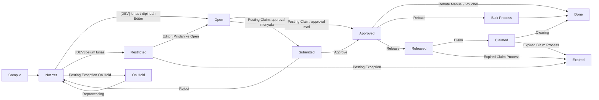

# PRD — Resource Collection Next Gen

Versi 2.0 • 17 Oktober 2026 • Pemilik produk: Daniel • Status: spesifikasi kerja berdasarkan kode, database dev/prod, dan keputusan pemilik sampai 17 Oktober 2026.

Dokumen ini membedakan **aturan aktif**, **implementasi yang sudah diuji**, dan **target berikutnya**. Target kapasitas maupun SLA bukan hasil pengukuran. Versi 1.1 (24 September 2026) beserta [spesifikasi 23-24 September](rc-release-2026-09-24.md) adalah riwayat; bila berbeda, dokumen ini yang berlaku.

**Status lingkungan per 17 Oktober 2026**

| Lingkungan | Supabase | Frontend | Isi |
|---|---|---|---|
| DEV | `fimjgmjjsplwgmuwzwbx` | https://resource-collection-dev.vercel.app, localhost `npm run dev:dev` | Seluruh fitur, termasuk Upload Debtor, Open/Restricted, dan Bad Debt (migrasi `20261163170000`) |
| PROD | `vvojshgcduqlugngpzkj` | https://rc.bi-nipponpaint.com | Sampai migrasi `20261163160000` (Amend Doc, CC per jenis, kode kejadian batch, tautan Customer Master) |

Aturan rilis: setiap perubahan masuk **dev lebih dulu**; prod hanya sesudah disetujui pemilik. Fitur yang baru ada di dev ditandai **[DEV]**.

Aturan nominal: kartu ringkasan report memakai satuan **jt**; Details dan ekspor memakai rupiah penuh tanpa pecahan (dipotong, bukan dibulatkan). Persentase serta jumlah dokumen memakai satuannya sendiri.

## 1. Masalah, tujuan, dan ukuran keberhasilan

Resource Collection mengelola klaim cashback depot, mulai dari compile dokumen, kelengkapan pengajuan, persetujuan, release, penagihan ke Finance, sampai clearing dan laporan. Sistem legacy menggunakan Spreadsheet/Apps Script; migrasi memindahkan otorisasi dan transaksi ke Supabase, dengan frontend statis di Vercel.

Tujuan produk:

1. Status klaim mencerminkan keputusan yang benar-benar disetujui.
2. Setiap pengguna hanya mengakses depot dan tab dalam kewenangannya.
3. Akun tidak pernah setengah terbentuk: Auth, profil, yurisdiksi, dan audit konsisten.
4. Tampilan, navigasi, format identitas, dan hasil bisnis yang telah disepakati dipertahankan.
5. Laporan dapat ditelusuri ke data dan definisi perhitungan yang sama.
6. **[DEV]** Hanya klaim toko yang sudah lunas menurut data debtor SAP yang dapat diajukan.

| Indikator | Kriteria penerimaan |
|---|---|
| Registrasi valid | Akun muncul setelah refresh server; role, depot/OSC/region sama dengan pilihan yang disimpan |
| Retry transaksi | Request ID yang sama tidak menghasilkan transaksi/akun kedua |
| Approval | Approval menyala: submit menjadi Submitted sampai diputuskan; mati: langsung Approved |
| Hak akses | Permintaan lintas depot, tanpa tab, dan eskalasi role ditolak server |
| Audit | Aktor berasal dari JWT; keputusan, batch, dan alasan dapat ditelusuri per dokumen |
| Log | Log Activity satu baris per proses, bukan per dokumen |
| **[DEV]** Gerbang lunas | Pengajuan klaim di luar Open ditolak server dari jalur mana pun |
| Mutu data | Temuan memiliki jumlah, definisi query, pemilik tindak lanjut, dan bukti penyelesaian |
| Kapasitas | Diterima hanya setelah pengukuran staging, bukan berdasarkan halaman masih terbuka |

## 2. Cakupan dan batas

### 2.1 Cakupan aktif

Auth dan sesi; registrasi mandiri, registrasi dan upload user oleh pengelola; Access Management (Daftar User, Registrasi, Approval Request, Arsip User, Email Otomatis, Email Pengajuan, Approval On/Off, Exclude Campaign, Grade Depot); Claim Upload (Mass Upload, Manual Input, Open, **[DEV]** Restricted; Posting Claim dan Posting Exception); Management of Approval (Within Payment Term, Overdue, On Hold & Expired, **[DEV]** Bad Debt, History); Release; Claim Process (Claim, Clearing); Bulk Process (Rebate); Key Master (Customer, Campaign, Depot); Document Center (Cashback List, Compile, Reprocessing Doc, Amend Doc, **[DEV]** Upload Debtor, Arsip); Analytics; Report dan dashboard publik; Timetable; People Performance; Log Activity; email pengajuan dan email otomatis.

Pengembangan mempertahankan struktur UI. Penyesuaian pilihan, validasi, notifikasi, dan perilaku tombol diperbolehkan untuk menyelaraskan UI dengan backend.

### 2.2 Ditunda

- Print Document dan parser/sumber Upload_CB legacy belum dimigrasikan.
- Pengujian 1.000.000 klaim dan hingga 1.500 concurrent users; project yang dipakai depot (prod) tidak boleh menjadi target stress test. Project dev dapat dipakai untuk uji fungsional, bukan pengganti staging beban.
- Pengiriman email sungguhan dari dev (kredensial Gmail tidak dipasang di dev; ditunda atas instruksi pemilik, 17 Oktober 2026).

## 3. Pengguna, peran, dan yurisdiksi

**Peran menentukan jangkauan depot; tab yang dicentang menentukan tindakan** (keputusan pemilik 6 Oktober 2026). Siapa pun yang diberi sebuah tab dapat menjalankan seluruh aksinya dalam jangkauan depotnya. Menyembunyikan tombol hanya membantu pengguna; otorisasi selalu diperiksa server (`can_tab`/`require_tab` + `can_access`).

| Role kanonis | Label | Sumber depot efektif |
|---|---|---|
| `admin` | Admin Depot | Grant depot RP |
| `osc` | OSC | Depot assigned |
| `others` | Non-OSC | Depot assigned; departemen terpisah |
| `finance` | Finance | Depot assigned |
| `depot head` | Depot Head | Depot assigned; hak modul melekat pada role (bawaan WPT saja) |
| `management` | Management | Area depot langsung dan/atau region terpilih; hak modul melekat |
| `supervisor` | Supervisor | Area depot langsung dan/atau gabungan depot OSC binaan |
| `system manager` | System Manager | Seluruh depot; memegang semua tab |

Ketentuan:

- Pemegang tab Access Management mengelola akun dalam kewenangannya. Pemegang non-Supervisor hanya dapat memberi peran setingkat dirinya ke bawah (tidak pernah Supervisor/Management/System Manager) dan hanya izin yang ia pegang.
- **Tab opt-in** (bawaan tidak tercentang, termasuk untuk akun baru): Approval On/Off, Amend Doc, **[DEV]** Upload Debtor, Bad Debt (Management of Approval), Restricted (Editor), Bad Debt (Tandai). Depot Head bawaannya tidak memegang Overdue serta On Hold & Expired sampai dicentang.
- Depot asal adalah identitas organisasi; depot efektif adalah izin baca/tulis.
- Perubahan role membersihkan mapping yang tidak lagi sesuai; mengubah identitas saja tidak menonaktifkan akun atau menghapus permission yang tidak dikirim.
- Akun Pending, Rejected, nonaktif, deleted, suspended, atau wajib ganti PIN tidak mengakses operasi bisnis.
- Penghapusan akun dibatasi System Manager, dengan alasan; arsip dapat dipulihkan.

## 4. Perjalanan pengguna

### 4.1 Pendaftaran dan registrasi

Pendaftaran mandiri membuat profil Pending; pengelola dalam scope meninjaunya. Registrasi oleh pengelola dan upload user (template tujuh kolom: User ID, Nama Lengkap, Kode Depot, Email, Role, PIN, Resource Partner / Area) mengikuti [spesifikasi upload user](rc-user-upload-approval.md). Suffix akun dibuat server. Akun baru wajib mengganti PIN awal.

### 4.2 Klaim normal (end-to-end)

1. **Key Master** disiapkan (bagian FR-MASTER).
2. **Document Center > Compile** (OSC): unggah compile cashback, maksimal 2.000 baris; dokumen dibuat **Not Yet**. Abbr No Doc mengikuti Depot Master; gross up dihitung sistem; nominal dipotong tanpa desimal.
3. **[DEV] Document Center > Upload Debtor** (OSC): unggah ekspor SAP ZDAGE; klaim toko yang lunas ditawarkan ke depot dengan batas proses 7 hari (FR-DEBTOR).
4. **Claim Upload > Open** (admin depot): hanya klaim yang siap diajukan **[DEV: lunas atau dipindah dari Restricted]**. Pindahkan ke Mass Upload (Tgl Lunas terisi dari tarikan ZDAGE) atau unduh template, lengkapi data, lalu **Posting Claim**.
5. **Management of Approval** bila approval menyala; bila mati, pengajuan langsung Approved.
6. **Release** → Released; **Claim Process > Claim** → Claimed; **Clearing** → Done dengan tanggal transfer/proses aktual yang dipilih pengguna (itulah Tgl Done).
7. Rebate lewat **Bulk Process**; Rebate Manual dan Voucher Done setelah disetujui.

Setiap transisi menyimpan aktor, versi, batch, alasan bila ada, dan riwayat per dokumen.

### 4.3 Pengecualian

- **Posting Exception** (Claim Upload): On Hold atau Expired. Approval menyala: menunggu keputusan di tab On Hold & Expired; mati: langsung berlaku. **[DEV]** Klaim Restricted hanya dapat di-Expired.
- **Expired dari Claim Process** (Released/Claimed) berlaku langsung.
- **Reprocessing Doc**: On Hold kembali Not Yet dengan nilai revisi; alasan wajib; email ke depot.
- **Amend Doc**: mengubah Net CB dokumen status apa pun (kecuali tanpa Customer Master); banyak dokumen sekaligus, alasan per baris atau umum; satu baris salah membatalkan semuanya; email peringatan ke depot.
- Reject di tiap tahap mengembalikan dokumen satu tahap (atau ke Not Yet) dengan alasan.

### 4.4 Pemantauan

Analytics (History dengan kolom Remark, Summary), Report, dashboard publik (identik dengan Report, tanpa identitas customer/rekening/KTP/NPWP), Timetable (Expired dihitung selesai seperti Done), People Performance, dan Log Activity, sesuai scope.

## 5. Persyaratan fungsional dan acceptance criteria

### FR-AUTH — Login, sesi, dan PIN

| ID | Persyaratan | Acceptance criteria |
|---|---|---|
| AUTH-01 | Login User ID + PIN menggunakan Supabase Auth | PIN dikirim utuh; tidak disimpan di log/frontend storage |
| AUTH-02 | Kompatibilitas alias legacy | Casing input dicoba dahulu, lalu uppercase/lowercase hanya pada invalid credentials |
| AUTH-03 | Identitas kanonis | User ID dipangkas dan uppercase; huruf, angka, titik, underscore, strip; unik |
| AUTH-04 | Sesi | Bertahan saat reload (sessionStorage), berakhir saat browser/tab ditutup; logout membersihkan sesi |
| AUTH-05 | Gate PIN awal | Data bisnis tidak dikembalikan sebelum PIN diganti |
| AUTH-06 | Suspended | 3 PIN salah berturut-turut men-suspend akun di server; reaktivasi mempertahankan ID dan PIN |
| AUTH-07 | Status akun | Pending/Rejected/nonaktif/suspended memiliki pesan jelas dan tidak diberi data bisnis |

### FR-ACCESS — Access Management dan Registrasi

| ID | Persyaratan | Acceptance criteria |
|---|---|---|
| ACCESS-01 | Satu katalog role dan tab server | Matriks izin dibangun dari `tab_catalog`; tab opt-in tidak tercentang kecuali sudah diberi |
| ACCESS-02 | Pilihan sesuai scope | Depot/OSC/region di luar kewenangan tidak ditawarkan dan ditolak bila payload dimanipulasi |
| ACCESS-03 | Anti-eskalasi | Pemberi hanya memberi peran setingkat ke bawah dan izin yang ia pegang |
| ACCESS-04 | Pembuatan atomik | Auth + profil + mapping + ledger + audit atomik; upload user lewat Pending + approval |
| ACCESS-05 | Idempotensi | UUID request sama + payload sama mengembalikan hasil yang sama; payload berbeda ditolak |
| ACCESS-06 | Approval On/Off | Saklar sistem dengan alasan dan riwayat; dokumen yang sudah diajukan tetap diputuskan |
| ACCESS-07 | **[DEV]** Approval Bad Debt | Saklar terpisah (bawaan mati) dengan alasan dan riwayat |
| ACCESS-08 | Email Pengajuan | Saklar aktif, mode uji + alamat uji, CC Semua Email, CC wajib per jenis (bagian FR-EMAIL) |
| ACCESS-09 | Keamanan rendering | Nama, label master, dan detail log diperlakukan sebagai teks |

### FR-CLAIM — Claim Upload

- Batas Claim Upload 500 baris per proses (server membagi daftar lebih panjang per 500).
- Preview memvalidasi dokumen, versi, field wajib, angka, tanggal, rekening, dan identitas pajak sesuai Jenis CB. NPWP terisi = Badan (KTP hanya tampil di Customer Master); Transfer memerlukan No/Nama Rekening dan Bank.
- Nomor rekening, kode customer, KTP/NPWP, dan nomor dokumen adalah teks; leading zero tidak hilang.
- Tgl Lunas wajib saat Posting Claim. Format tanggal masukan: dd-mm-yyyy, dd.mm.yy, ddmmyy, ddmmyyyy; tampilan dd-Mmm-yyyy.
- Jenis CB yang diketik adalah override terkontrol (Transfer, CN, Voucher, Rebate, Rebate Manual); bila berbeda dari Campaign Master, dokumen bertanda "CB Type Changed".
- Rekening yang diisi berbeda dari master memperbarui Customer Master (satu baris log per proses).
- Dokumen tanpa Customer Master terlihat tetapi tidak dapat diproses.
- Expired dan On Hold dikunci dari Posting Claim; hanya lewat Posting Exception / Reprocessing.
- **[DEV]** Hanya klaim di Open yang dapat diajukan; dokumen Restricted ditandai "Restricted (belum lunas)" di preview dan ditolak server.
- Hasil parsial menyebut dokumen berhasil/gagal dan alasannya.

### FR-APPROVAL — Management of Approval

| Kejadian | Status sebelum keputusan | Hasil keputusan |
|---|---|---|
| Submit normal (approval menyala) | Submitted + pending submit | Approve → Approved; Reject → Not Yet |
| Submit, approval mati | — | Langsung Approved; email "pengajuan langsung" |
| Submit Rebate Manual / Voucher | Submitted (bila approval menyala) | Approve → Done; approval mati → langsung Done |
| Overdue | TOP aktual melebihi TOP master | Diputuskan di tab Overdue (tidak memblokir upload) |
| Hold / Expired dari Upload | Status efektif sebelumnya + pending | Efektif sesudah approve; approval mati → langsung |
| Expired dari Claim Process | Released/Claimed | Langsung Expired |
| **[DEV]** Toko Bad Debt, Approval Bad Debt menyala | Submitted + pending Bad Debt | Hanya di tab Bad Debt (bukan WPT/Overdue); Approve → Approved (Done untuk RM/Voucher) |

`pending_approval` adalah permohonan, bukan status workflow tambahan.

### FR-WORKFLOW — Release, Claim, Clearing, Bulk Process

Transisi memeriksa status, tab, depot, versi, dan kelengkapan. Rebate hanya lewat Bulk Process; Bulk Process tidak menyentuh non-Rebate. Clearing mewajibkan tanggal transfer/proses aktual (tidak boleh di masa depan); Tgl Done = tanggal itu dengan jam proses WIB. Batch dan timestamp dibuat server. Request ID berbeda dengan versi lama ditolak.

**Nomor batch** (15 karakter, satu nomor urut per proses): `K T SSS DDMMYY NNNN`

- K = kejadian terakhir dokumen: 0 biasa, 1 Amend Doc, 2 Reprocessing, 3 Expired, 4 Jenis CB diganti. Terbawa ke proses berikutnya; batch yang sudah terbit tidak diubah; bila beberapa kejadian, yang terakhir berlaku.
- T = tahap: 1 Submit, 2 Release/Bulk, 3 Claim, 4 Done/Expired, 5 Compile.
- SSS = suffix akun (3 digit, unik, terkunci setelah dipakai); DDMMYY = tanggal proses WIB; NNNN = urutan per tahap+suffix+hari, tidak pernah berulang.
- Dokumen dengan kode berbeda dalam satu proses hanya berbeda digit pertama. Batch legacy 13–14 digit.

### FR-MASTER — Key Master

- **Customer**: kode, nama, Kode Depot (wajib untuk customer baru), TOP, KTP, NPWP, subyek pajak, rekening, contact person. Unggah massal otomatis per 2.000 baris (maks 50.000 baris / 20 MB) dengan pemeriksaan lebih dulu; **sel kosong = data lama dipertahankan, "-" = dikosongkan**. Menyimpan Customer Master otomatis menautkan klaim "Customer Master belum ada" dengan kode sama, mengisi Subyek Pajak/Gross Up yang kosong. **[DEV]** Label Bad Debt.
- **Campaign**: kode, nama, Jenis CB, status pajak, periode campaign, SO start/end, Billing start/end, status, memo, Exclude Campaign.
- **Depot**: kode, nama, Abbr, region, alamat, Email TO, Email CC, Email Kepala Admin, grade.
- Data diarsipkan, bukan dihapus, dan dapat dipulihkan. Data sumber anomali tidak diisi dengan tebakan.

### FR-DOC — Document Center

| Tab | Aturan |
|---|---|
| Cashback List / Compile | Filter langsung, 100 baris per halaman, pilih lintas halaman, unduh kolom terpilih; compile tanpa kolom Abbr (ikut Depot Master), maks 2.000 baris |
| Reprocessing Doc | Hanya On Hold; total cashback revisi + alasan wajib; gross up dihitung ulang; email ke depot |
| Amend Doc (opt-in) | Banyak dokumen (maks 200), template/copas, semua status; remark "Doc Amendment - <tahap>", pelaku merah di Process by; email peringatan |
| **[DEV]** Upload Debtor (opt-in) | FR-DEBTOR |
| Arsip | Arsip/pulihkan baris dengan alasan; dokumen tanpa master tetap dapat diarsip |

### FR-DEBTOR — [DEV] Upload Debtor, Open, Restricted, Bad Debt

**File ZDAGE**: sheet "Data", kolom A–T. A Distribution Channel (= kode depot), B Customer, C Customer Name, D Term-FI, E Over Due Amt, F Total, G–S 13 bulan mundur (G = bulan tarikan), T "<bulan S". Tanggal tarikan dari nama file EXPORT_YYYYMMDD_HHMMSS, atau wajib diisi. File ditolak seluruhnya bila header salah, bulan tidak berurutan, kode toko ganda, angka tidak terbaca, atau bulan tarikan lebih tua dari data yang berlaku. Kode toko yang tidak ada di Customer Master dibiarkan. Peringatan bila Total ≠ jumlah G..T.

**Cakupan**: hanya depot di kolom A yang dinilai dengan data baru. Pop up menampilkan depot lain dalam jangkauan: tidak dicentang = data debtor lama; dicentang "Tidak ada tagihan" = seluruh toko lunas; tanpa data = tidak dinilai.

**Penilaian per klaim Not Yet** (toleransi Rp 1, mode per kolom; Bulan SO = SO start, Bulan Bill = Billing end):

1. Lebih dulu: tanpa Customer Master; Bad Debt; dikembalikan depot; kode toko tidak ada di data → Lunas; campaign tanpa SO/Billing atau SO start sesudah Billing end → **Periode Salah**.
2. Skala prioritas: **1** tidak ada Over Due Amount; **2** lunas selama periode campaign (Bulan SO s/d Bill); **3** lunas sebelum periode campaign (termasuk T). Semua aturan gagal dicatat; penyebab utama = prioritas tertinggi yang gagal. Kolom sesudah Bulan Bill diabaikan.

**Pratinjau**: kartu Belum Lunas (Over due / Selama campaign / Sebelum campaign), Lunas, Bad Debt, Periode Salah, Campaign Bermasalah (ringkasan per campaign untuk perbaikan Campaign Master); tabel per klaim dengan penyebab; unduh.

**Terapkan** (idempoten): tawaran baru untuk Lunas dengan deadline hari ini + 7 (WIB); Tgl Lunas kosong diisi tanggal tarikan; tawaran aktif dinilai ulang — bila tidak lunas lagi dibatalkan dan klaim kembali ke Restricted; satu baris log. Job harian 07:00 WIB menandai tawaran lewat batas sebagai overdue dan mengantrekan **satu email per depot** (TO Email TO depot; CC Email CC depot + CC Semua Email + CC wajib Debtor; subjek "[RC] Warning – Toko lunas belum diproses – <Nama Depot>"; tabel Nama Campaign | Jumlah Toko | Total Net CB + Total; remark baku), berulang setiap hari sampai diproses atau dikembalikan.

**Open**: hanya klaim dengan tawaran aktif (atau toko Bad Debt bila Approval Bad Debt menyala). Kolom Deadline (7–5 hari hijau, 4–3 kuning, 2–1 oranye, 0 merah, lewat merah tua "Lewat X hari"), urut deadline terdekat; label "Restricted" untuk klaim pindahan; Kembalikan ke Not Yet (alasan wajib → Restricted, tidak ditawarkan otomatis lagi; OSC dapat menawarkan ulang dari Upload Debtor).

**Restricted** (terlihat bawaan, hanya baca): seluruh Not Yet lainnya dengan alasan (Belum lunas + rincian, Bad Debt, Periode salah, Dikembalikan depot, Belum ada data debtor, Belum dinilai). Pindah ke Open hanya pemegang **Restricted (Editor)** (alasan wajib, tanpa deadline). Pindah ke Posting Exception boleh siapa saja, **hanya Expired**. Tandai/Cabut Bad Debt dengan izin **Bad Debt (Tandai)**.

**Bad Debt** per toko dengan alasan; membatalkan tawaran aktif toko itu. Approval Bad Debt menyala → klaimnya di Open dan diajukan lewat tab Bad Debt; mati → tetap Restricted sampai Editor memindahkannya. Email pengajuan memuat remark "Bad Debt".

### FR-REPORT — Analytics, Report, dashboard publik, ekspor

- Definisi status, nilai, gross up, outstanding, dan filter sama antara aplikasi dan dashboard publik; Report dan dashboard publik memakai komponen bersama dan harus identik.
- Analytics History memiliki kolom **Remark** dari satu sumber: "Doc Amendment - <tahap>", "Document Reprocessed", "CB Type Changed" (boleh lebih dari satu).
- Unduhan Excel sama dengan layar: sumber sama, ID sebagai teks, nominal dipotong.
- Teks tabel (kode/nama toko, campaign, depot) dapat diblok dan disalin tanpa memicu klik.

### FR-OPS — Timetable, log, email, People Performance

- **Log Activity**: satu baris per proses (mis. "Workflow RELEASE: 19 dokumen") dengan batch di kolom Batch; jejak per dokumen di riwayat dokumen. Log tidak berisi PIN/token.
- Timetable per depot dan campaign; Expired dihitung selesai.

### FR-EMAIL — Email

- **Email Pengajuan** (antrean `email_outbox`, pengirim cron prod): jenis Pengajuan (approval mati), Approval & Approved, Done, On Hold & Expired, Amend Doc, Reprocessing, **[DEV]** Debtor. TO Email TO depot; email Done ke Email Kepala Admin bila diisi, subjek memuat nama depot. CC = OSC/Supervisor depot + CC Semua Email + CC wajib per jenis (`depots.email_cc` tidak dipakai kecuali email Debtor). Mode uji mengalihkan semua ke alamat uji dengan spanduk "MODE UJI".
- **Email Otomatis** terjadwal: Daily, Weekly, Timetable.
- **Dev hanya email uji**: penjaga server menahan email non-uji; kredensial Gmail dan cron pengirim tidak dipasang di dev.

## 6. Data, relasi, dan sumber kebenaran

| Entitas | Fungsi dan invariant |
|---|---|
| `auth.users` / `profiles` | Satu identitas Auth dengan satu profil; role/status/suffix dikendalikan server |
| `depots` / `depot_profiles` / `user_depot_access` | Master organisasi, profil/email depot, dan scope efektif |
| `user_supervision` / `user_region_access` | Sumber yurisdiksi Supervisor dan Management |
| `permissions` / `user_permissions` / `rc_private.tab_catalog` / `user_tab_access` | Katalog izin modul, tab, dan centang tab per akun |
| `customers` / `customer_depots` | Customer dapat terkait beberapa depot |
| `campaigns` | Aturan campaign, periode, SO dan Billing |
| `claims` | Dokumen, referensi master (`customer_id` atau `source_customer_code` bila master belum ada), nilai, versi, status, pending approval, batch, `batch_event_code`, `amended_at`, `bad_debt_remark_id` |
| `claim_status_history` / `activity_logs` | Riwayat per dokumen (aktor, batch, alasan) dan log satu baris per proses |
| `email_settings` / `email_outbox` | Konfigurasi dan status pengiriman email |
| `pengaturan_sistem` | `approval_aktif`, **[DEV]** `approval_bad_debt`, `zdage_toleransi`, `zdage_mode` |
| **[DEV]** `rc_zdage_uploads` / `rc_zdage_rows` / `rc_zdage_depot_data` / `rc_zdage_hasil` | Upload ZDAGE, barisnya, data debtor yang berlaku per depot, hasil penilaian terakhir per klaim |
| **[DEV]** `rc_clearing_offers` / `rc_bad_debt_remarks` | Tawaran (LUNAS/REOFFER/RESTRICTED; offered/overdue/processed/returned/cancelled) dan remark Bad Debt |

Seluruh tabel publik ber-RLS; tabel Upload Debtor hanya diakses lewat RPC. Field finansial bertipe numerik; nilai kosong tidak otomatis nol. Tampilan bisnis Asia/Jakarta. Prod 16 Oktober 2026: 32.416 klaim; 644 klaim masih tanpa Customer Master (313 kode).

## 7. Perhitungan bisnis

- **Gross up** dihitung sistem (`rc_private.gross_up_klaim`), disimpan bulat: 0 untuk Rebate, Rebate Manual, Voucher, dan campaign Rebate Non Tax; selain itu untuk semua status pajak — Badan flat 15%, Perorangan (atau subyek kosong) progresif. Subyek pajak dari Customer Master (NPWP = Badan; hanya KTP = Perorangan).
- **Periode dokumen** = periode campaign; On Hold menimpa SO/Billing selama tertahan; Reprocessing mengosongkan penimpaan.
- Input Document Center (compile, reprocessing, amend) dipotong tanpa desimal.
- Perubahan formula memerlukan contoh input/output yang disetujui pemilik sebelum mengubah saldo historis.

## 8. Kontrak API dan konsistensi

Frontend `src/parts` + `src/js` dibangun menjadi `public/index.html` (`node scripts/build-rc-frontend.mjs [--env dev]`); adapter `scripts/rc-legacy-adapter.js` menerjemahkan action UI menjadi RPC/Edge Supabase. Mutasi klaim lewat `rc_process_claims` (action, item + versi, request ID, alasan; maks 500 per panggilan). RPC Upload Debtor: `rc_zdage_stage`, `rc_zdage_preview`, `rc_zdage_apply`, `rc_zdage_discard`, `rc_zdage_riwayat`, `rc_clearing_return`, `rc_clearing_reoffer`, `rc_clearing_dikembalikan`, `rc_restricted_claims`, `rc_restricted_pindah`, `rc_bad_debt_set`, `rc_bad_debt_revoke`, `rc_bad_debt_approval_setelan/setel`, `rc_approval_bad_debt`. Server tidak memakai role/ID dari browser sebagai kewenangan. Kontrak Registrasi (`rc-admin` Edge) tidak berubah dari versi 1.1.

## 9. Persyaratan nonfungsional

### 9.1 Keamanan dan privasi

RLS aktif; anonymous tidak menulis tabel inti. Fungsi security definer memakai `search_path` kosong dan EXECUTE terbatas. Service role/PAT/token hanya di `.env` lingkungan kerja, tidak di bundle frontend, dokumen, atau git. Data sensitif tidak muncul di dashboard publik, log, atau audit agregat. Input yang dirender sebagai HTML di-escape.

### 9.2 Kinerja dan kapasitas — target, belum tersertifikasi

Rencana tetap mengikuti [load test plan](load-test-plan.md): staging terpisah, 1.000.000 klaim dummy, beban bertahap sampai 1.500 users, baseline dan threshold ditandatangani sebelum test utama. Kesenjangan: dokumen legacy dimuat sampai 20.000 baris; suffix akun 001–999.

### 9.3 Keandalan, observabilitas, dan UX

Request ID dapat ditelusuri; konflik versi memberi pesan muat ulang. Pesan membedakan gagal, berhasil-tetapi-refresh-gagal, dan tidak ada data. Kegagalan email dicatat tanpa membatalkan transaksi. Tidak ada retry otomatis tak terbatas.

## 10. Verifikasi dan release criteria

| Lapisan | Pemeriksaan wajib |
|---|---|
| Frontend | `npm run check` bersih; `npm test` (adapter, UI, parser ZDAGE) |
| Database | Suite SQL dengan subtransaksi yang dibatalkan (`supabase/tests/*.sql`), dijalankan di dev lalu prod sesudah transport |
| Migration | Penjaga MD5 pra-citra per fungsi; gladi di prod dalam transaksi yang dibatalkan sebelum transport; cadangan definisi di `.runtime/` |
| Browser | Uji puppeteer pada localhost → dev untuk alur yang berubah |
| UAT | Alur pengguna nyata per role; belum digantikan unit test |

Hasil 17 Oktober 2026 (dev): suite Upload Debtor 43/43; regresi 15/15, 10/10, 15/15, 20/20, 42/42; uji node 32/32; browser 9/9. `npm test` 95/97 — dua kegagalan format ekspor (Clearing Rate, ekspor Bulk) sudah ada sebelum Upload Debtor dan belum diperbaiki.

## 11. Deployment, rollback, dan operasional

Urutan: kerjakan di dev → uji → minta persetujuan pemilik → cocokkan MD5 pra-citra prod → gladi di prod (transaksi dibatalkan) → cadangkan definisi/data terdampak → terapkan migration satu per satu → uji pascatransport di prod → `npm run deploy` (frontend prod) → build ulang lokal untuk dev. Jangan `supabase db push`; ledger migration remote tidak sinkron sejak 15 September 2026, jadi hanya file yang dimaksud yang diterapkan. Rollback memakai definisi fungsi yang dicadangkan; kolom/tabel yang sudah berisi transaksi diperbaiki maju, bukan dihapus.

## 12. Prioritas tindak lanjut dan keputusan terbuka

| Prioritas | Pekerjaan | Selesai bila |
|---|---|---|
| P1 | Transport Upload Debtor/Restricted ke prod (`20261163170000`) | Disetujui pemilik. **Dampak**: begitu terpasang, depot tidak dapat mengajukan klaim sampai OSC meng-upload ZDAGE untuk depotnya atau Editor memindahkan klaim ke Open |
| P1 | Campaign tanpa SO/Billing (prod: 153 klaim) | Campaign Master dilengkapi sebelum/bersamaan transport Upload Debtor |
| P1 | Customer Master untuk 644 klaim / 313 kode tanpa master | Master diisi; klaim otomatis tertaut |
| P1 | Tick email otomatis 07:05 WIB gagal ("Akses tab access.email tidak diizinkan") karena penyusun email menuntut tab saat dijalankan cron | Daily/Weekly/Timetable terjadwal dapat terkirim lagi |
| P1 | Isi CC wajib per jenis dan Email Kepala Admin di prod | Seluruh depot terisi |
| P2 | Dua tes format ekspor yang gagal | `npm test` 97/97 |
| P2 | Email dev sungguhan (kredensial Gmail di dev) | Ditunda atas instruksi pemilik |
| P2 | Staging beban, UAT seluruh role, hardening CSP | Bukti tersimpan dan checklist ditandatangani |

Keputusan terbuka: urutan prioritas bila beberapa kejadian batch terjadi (saat ini kejadian terakhir yang berlaku); pengecualian cashback melebihi nilai transaksi; retensi audit; format suffix setelah 999; SLA/RPO/RTO.

## 13. Referensi implementasi

- Migration utama terbaru: [Upload Debtor](../supabase/migrations/20261163170000_upload_debtor_zdage.sql) [DEV], [kode kejadian batch + tautan Customer Master](../supabase/migrations/20261163160000_batch_kode_kejadian_dan_tautan_customer_master.sql), [Amend + CC per jenis](../supabase/migrations/20261163150000_amend_email_cc_per_jenis_log_ringkas.sql), [Amend Doc](../supabase/migrations/20261163140000_amend_doc_dan_remark_kejadian.sql), [Tgl Done Clearing](../supabase/migrations/20261163130000_tgl_done_ikut_clearing_dan_periksa_customer.sql)
- Frontend: [Upload Debtor](../src/js/51-upload-debtor.js), [Open](../src/js/85-tab-open.js), [Restricted](../src/js/86-tab-restricted.js), [Amend Doc](../src/js/49-amend-doc.js), [Approval](../src/js/47-approval.js), [adapter](../scripts/rc-legacy-adapter.js)
- Uji: [Upload Debtor](../supabase/tests/rc_zdage.sql), [batch & tautan master](../supabase/tests/rc_batch_kejadian_dan_tautan_master.sql), [parser ZDAGE](../scripts/test_zdage_parser.mjs)
- [Prompt workflow untuk AI](prompt-workflow-resource-collection-dev.md), [lingkungan dev](lingkungan-dev.md), [muat ulang data prod](muat-ulang-data-prod.md), [aturan approval](rc-approval-fix.md), [rute aplikasi](rc-rute.md), [upload user](rc-user-upload-approval.md)
