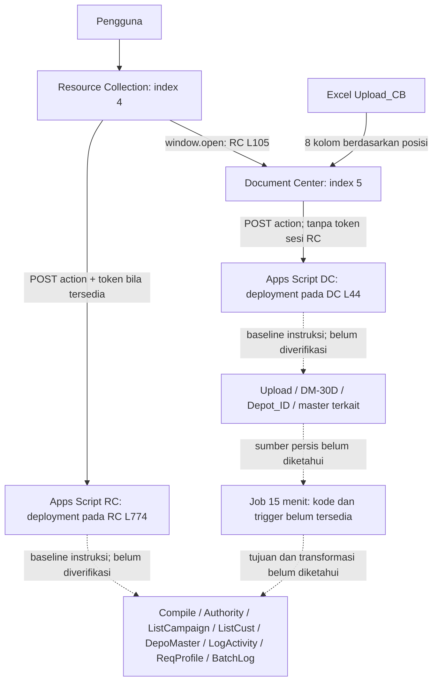
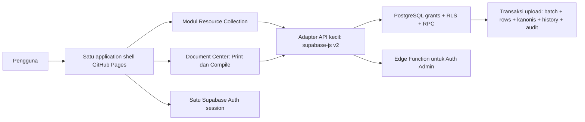

> CATATAN HISTORIS: baseline sebelum kedua backend tersimpan. Pernyataan file kosong/backend belum tersedia berlaku pada saat audit awal. Untuk status terbaru lihat [audit utama](phase-0-audit.md) dan [audit backend](phase-0-backend-audit.md).

> Penetapan Supabase juga diperbarui oleh pemilik menjadi **DEV**. Label PROD dalam catatan historis ini bukan target aktif; lihat [lingkungan proyek](environments.md).

# Fase 0 — Audit Resource Collection dan Document Center

Tanggal audit: 14 September 2026. Pembaruan koneksi dan inventaris Supabase: 14 September 2026, 09:29:52 UTC. Status: **BLOCKED_BY_SYNC_INVENTORY**.

Dokumen acuan: `../System-Instruction-Migrasi-Claim-System-ke-Supabase.md`, versi 1.1. Audit ini mengikuti batas Fase 0: tidak mengubah aplikasi, membuat schema final, memanggil deployment Apps Script produksi, atau mengubah trigger. Pemeriksaan lanjutan memakai MCP untuk membaca metadata Supabase PROD yang dikonfirmasi pemilik. Ini adalah audit parsial sumber yang tersedia; audit backend, inventaris Spreadsheet produksi, baseline latency, dan rekonsiliasi belum selesai.

Koneksi MCP telah terverifikasi melalui respons project URL, inventaris tabel/migration/Edge Function, dan SELECT metadata. Rincian baru ada di [audit Supabase](phase-0-supabase-audit.md), [bukti JSON](phase-0-supabase-evidence.json), dan [daftar bahan Fase 0](phase-0-source-intake.md). Koneksi MCP bukan bukti frontend sudah terintegrasi dengan Supabase.

## 1. Sumber dan tingkat kepastian

| Sumber | Keadaan | Cakupan bukti |
|---|---|---|
| `index (4).html` | 293.699 byte | Frontend Resource Collection; UI, request, transformasi dan ekspor lokal |
| `index (5).html` | 52.215 byte | Frontend Document Center; React, print, import, login, submit |
| `Pasted text.txt` | Tidak tersedia | Backend RC belum dapat diverifikasi |
| `Pasted code.js` | Tidak tersedia | Backend Document Center belum dapat diverifikasi |
| `ResourceCollection`, `DocumentCenter` | Masing-masing 0 byte | File kosong, bukan implementasi backend |
| Kode sinkronisasi 15 menit dan metadata trigger | Tidak tersedia | Mapping upload dan cutover terblokir |
| Header, data anonim, formula Spreadsheet | Tidak tersedia | Tidak ada data dictionary produksi yang dapat disahkan |
| Supabase project `vvojshgcduqlugngpzkj` | MCP terhubung; pemilik mengonfirmasi **PROD** | Inventaris metadata berhasil; belum ada tabel public, migration, atau Edge Function |
| Konfigurasi DEV, repository dan deployment Pages | Belum dikonfirmasi | PROD tidak digunakan sebagai lingkungan development; backend Apps Script tetap belum terinventarisasi |

Penanda bukti:

- **Fakta frontend**: terlihat langsung pada sumber, dengan referensi `RC:L...` untuk `index (4).html` dan `DC:L...` untuk `index (5).html`.
- **Baseline instruksi**: pernyataan dalam dokumen acuan, belum dibuktikan dari backend/data produksi.
- **Rancangan**: target yang diwajibkan instruksi, bukan implementasi yang telah dibuat atau diuji.
- **Belum diketahui**: tidak boleh digantikan asumsi atau keputusan implisit.

## 2. Arsitektur saat ini



Dua URL Apps Script berbeda tertanam di frontend. Deployment ID tidak membuktikan Apps Script project ID, owner, konfigurasi akses, atau Spreadsheet tujuan. GitHub Pages adalah hosting menurut instruksi; link Print-Document terlihat pada RC:L105. Repository RC dan konfigurasi Pages belum diketahui. Kedua backend dan seluruh Spreadsheet pada diagram belum diaudit.

RC memakai JavaScript inline, Tailwind, Chart.js dan SheetJS (RC:L7–10). DC memakai shell React/ReactDOM sendiri, Babel runtime, Tailwind, Lucide, ExcelJS, FileSaver dan html2pdf yang dimuat sejak awal (DC:L8–24). Tab awal DC adalah Compile Cashback (DC:L719). Counter satu detik RC:L1076–1078 hanya jam durasi sesi; **bukan bukti polling backend atau job sinkronisasi**.

## 3. Inventaris endpoint yang dipanggil frontend

Daftar ini lengkap untuk literal `action:` yang ditemukan: 18 aksi RC dan 5 aksi DC. Route backend tambahan, default lookup, metode GET, kontrol sesi, dan efek tulis sebenarnya masih perlu dibaca dari kedua backend.

RC memakai `fetchApp()` yang menambahkan `currentUserData.token` bila tersedia (RC:L1196–1216); login memakai fetch langsung. Pengiriman token tidak membuktikan server memvalidasinya atau mengabaikan role dari body.

| Aksi RC | Bukti | Input utama dan keluaran yang dipakai | Data/efek menurut frontend |
|---|---|---|---|
| `login` | L1264–1304 | userid, pin → data, campaigns, customers, documents, depots | Profil dan dataset disimpan di global browser |
| `logout` | L1224 | userId | Reload meskipun request gagal |
| `refreshDocuments` | L1104–1115 | tanpa filter/cursor → documents | Ganti seluruh array dokumen |
| `logActivity` | L1218–1221 | userId, role, detail, timestamp | Audit dikirim terpisah; error diabaikan |
| `submitData` | L1522–1546 | userData, data → summary.batchNum/successfulDocs/grossUpMap | Posting claim; UI menyatakan dapat mengubah master rekening |
| `markExpired` | L1551–1581 | docsToProcess, userData | Expired dari Posting Exception |
| `toggleOnHold` | L1569–1570 | docsToProcess, holdAction=hold, userData | Hold; jalur unhold belum ditemukan di frontend |
| `getWorkflowData` | L1588–1595 | requesterId/Role, managedDepots | Empat array release/claim/clearing/bulk sekaligus |
| `bulkFastTrackRelease` | L1640–1659 | docsToProcess, userData | Langsung Done untuk antrian rebate menurut UI |
| `processWorkflow` | L1854–1889 | docsToProcess, workflowType, actionType, tglProses, userData | Approve/reject; expired juga dikirim dari claim/clearing |
| `getDashboardData` | L1921–1928 | requesterId/Role, managedDepots → history, compileData | Dua array untuk analytics browser |
| `getManageableData` | L2138–2158 | requesterId/Role → users, depots, profileRequests | Daftar akun/depot/request |
| `approveProfileRequest` | L2178–2185 | reqId, status, approverId/Role | Review perubahan profil |
| `updateUserAccess` | L2238–2253 | requesterRole, targetUserId, auth, q, mapping, approvePin | Ubah akses/role/PIN; Q berada di luar objek auth |
| `addAccount` | L2292–2300 | requesterId/Role, nama, userId, pin, email, role, depot, mapping | Registrasi; role Non-OSC dikirim sebagai nama departemen |
| `getLogActivity` | L2303–2310 | requesterId/Role, managedDepots → logs | Filter dan pagination lokal |
| `submitProfileUpdate` | L1344–1350 | sysRole, kodeDepot, namaDepot, requesterId, changes | Alamat, pimpinan, jumlah karyawan |
| `requestPinChange` | L2352–2358 | userId, newPin | Request ganti PIN |

| Aksi DC | Bukti | Input/keluaran | Catatan |
|---|---|---|---|
| `lookupBatch` | L79–123 | lookupType, batchNumbers → data | Tidak menyertakan token RC atau pagination server |
| `log_print` | L156–160 | detailActivity | Fire-and-forget, no-cors, tanpa actor sesi RC |
| `previewCashback` | L293–370 | extractedData → data | Sebelum login lokal; seluruh hasil menjadi previewData |
| `login` | L385–412 | username, password → name | Menyimpan hanya nama pada sessionStorage |
| `submitCashback` | L415–446 | previewData, username=loggedInName → summary/rejected | Tidak mengirim token sesi RC, hash file, atau idempotency key |

Pemetaan aksi ke sheet merupakan **baseline instruksi**, bukan bukti dari implementasi backend. Perlu melengkapi setiap route dengan handler, sheet/range dibaca/ditulis, validasi sesi, role/depot, lock, formula, dan bentuk respons sukses/gagal.

## 4. Matriks role × permission × depot

Matriks berikut hanya menggambarkan **visibilitas UI**, bukan otorisasi server (RC:L1306–1316). `flag` berarti nilai `yes`, `approved`, `true`, atau `visible` diterima oleh `parseAuthBool`; fungsi ini tidak melakukan trim.

| Modul | System Manager | Supervisor | OSC | Admin / Non-OSC / role lain |
|---|---|---|---|---|
| Claim Upload | Ya | J | J | J |
| Release | Ya | K | K | K |
| Claim/Clearing | Ya | L | L | L |
| Analytics | Ya | M atau D | M atau D | M atau D |
| Kelola Akses | Ya | Ya | N | N |
| Log | Ya | Ya | Ya | Tidak |
| Master Depot | Ya | P | P | P |
| Document Center | Ya | Q | Q | Q |
| Bulk | Ya | S | S | S |

Mapping target: J→upload_claim; K→release_claim; L→process_claim; M/D→view_analytics (D perlu klarifikasi); N→manage_access; P→view_master_depot; Q→view_document_center; S→bulk_process. `view_logs` saat ini berasal dari role. `print_documents`, `upload_campaign_compile`, dan `review_campaign_upload` belum memiliki mapping tersendiri yang terbukti.

Scope depot UI:

- Preview manual/mass: System Manager melewati cek `managedDepots`; semua role lain, termasuk Supervisor, harus cocok dengan `dcCode` (RC:L849–853, L1422–1450).
- Supervisor/System Manager melihat filter depot dan sebagian filter OSC. OSC melihat filter depot. Ini tidak membuktikan scope query server.
- Kelola akses memanfaatkan allDepots untuk System Manager/Supervisor; role lain menggunakan managedDepots (RC:L2145).
- Mapping admin→OSC dan OSC/Non-OSC→depot tampak di editor (RC:L2220–2230). Bentuk relasi sebenarnya perlu header Authority/DepoMaster.
- Profil yang dapat diajukan: sysRole admin, kepala depot, osc (RC:L1321). Normalisasi `sysRole` versus `role` harus diaudit; frontend menggunakan keduanya secara tidak seragam.
- Login menolak nonactive/denied/pending/block, tetapi editor menggunakan Inactive/Suspended/Disabled (RC:L1280–1283, L2197–2201). Penolakan server wajib diverifikasi untuk seluruh variasi.
- DC tidak menggunakan matriks RC setelah link dibuka. Print/preview tersedia dalam shell tanpa sesi RC; login lokal baru muncul menjelang submit.

## 5. State transition table awal

Transisi database belum bisa disahkan tanpa backend. Tabel menggabungkan target instruksi dengan aksi yang terlihat; field yang dihapus saat reject dan side effect harus dikonfirmasi.

| Asal | Aksi | Tujuan target | Bukti dan ketidakpastian |
|---|---|---|---|
| blank / Not Yet | submitData | submitted | UI menolak status lain; patch lokal Submitted L1541; transaksi server belum diperiksa |
| submitted | release approve | released | Tombol release dan processWorkflow; target dari instruksi |
| released | claim approve | claimed | Tombol claim dan processWorkflow; ekspor otomatis setelah berhasil |
| claimed | clearing approve | done | Memakai tanggal clearing input; target dari instruksi |
| submitted | release reject | not_yet | Instruksi; field upload/batch yang dihapus belum diketahui |
| released | claim reject | submitted | Instruksi; side effect belum diketahui |
| claimed | clearing reject | released | Instruksi; side effect belum diketahui |
| not_yet | toggleOnHold/hold | on_hold | Preview exception membatasi Not Yet, L1432–1440 |
| on_hold | unhold | previous_status | Diwajibkan instruksi; pemanggil UI dan implementasi belum ditemukan |
| not_yet | markExpired | expired | Posting Exception |
| released | processWorkflow/claim/expired | expired? | **Tombol nyata RC:L422**; bertentangan dengan pembatasan exception; perlu keputusan |
| claimed | processWorkflow/clearing/expired | expired? | **Tombol nyata RC:L474**; perlu keputusan |
| submitted/released/claimed | bulkFastTrackRelease | done | Rebate menurut UI L580 dan target instruksi; master aktif server belum diperiksa |
| done | hold/expired | Ditolak | Ketentuan target; backend belum diuji |
| expired | seluruh mutasi normal | Ditolak | Terminal menurut instruksi dan label UI |
| RA07/RA7 | normalisasi baca | Done | Bukan transaksi: normalizeClaimStatus L1085–1091, juga dipakai login/refresh/history |

Format batch target dari instruksi: tahap 2 digit + suffix 3 digit + ddMMyy + counter 4 digit. UI menerima batch dari summary backend; konstanta 02/03/04 ada di L1863 tetapi tidak dikirim sebagai batch. Alokasi, timezone bisnis, reset counter, overflow >9999, dan batch fast-track belum diverifikasi. Jangan menyimpulkan suffix dari kode depot.

## 6. Upload_CB dan Print Document

### Upload cashback yang terlihat

1. File input membatasi pilihan `.xlsx`, tetapi tidak ada batas byte/row yang tampak pada parser (DC:L640, L293–370).
2. Parser mencari sheet dengan trim+lowercase `upload_cb`; baris pertama dilewati tanpa validasi header.
3. Setiap baris nonkosong yang diiterasi setelah header diubah berdasarkan posisi delapan kolom berikut.

| Posisi file | Header template | Payload | Perlakuan frontend |
|---|---|---|---|
| A | Kode Campaign | kodeCampaign | String, trim |
| B | DC | dc | String, trim |
| C | Cust Code | custCode | String, trim |
| D | Cust Name | custName | String, trim |
| E | Net Value | netValue | parseFloat; NaN menjadi 0 |
| F | Total | total | parseFloat; NaN menjadi 0 |
| G | Jenis CB | jenisCb | String, trim |
| H | Before Tax Val | beforeTaxVal | parseFloat; NaN menjadi 0 |

Formula dibaca dari cached result, rich text digabung, Date menjadi ISO (DC:L320–337). Tidak ada pemeriksaan formula stale, duplikat internal, angka negatif, identifier kosong atau header tertukar dalam parser ini. Nilai identifier yang sudah hilang leading zero di Excel tidak bisa dipulihkan dengan String.

4. Preview mengirim semua row ke backend, lalu menyimpan semua hasil. Pagination 20 baris dilakukan setelah respons diterima.
5. Submit memakai data hasil preview dan nama browser. Preview belum membuktikan permission atau validasi commit. Summary accepted/rejected mengindikasikan UI mendukung hasil campuran, tetapi **tidak membuktikan mode partial accept server**.
6. Mapping `Upload_CB → payload` dapat dipetakan; `payload → Upload → job → tujuan RC` **belum diketahui**. Nomor baris sumber dan file hash tidak dipertahankan pada payload yang terlihat.

**Defect terkonfirmasi:** generator mengeluarkan sheet `Template` (DC:L272), sementara importer mensyaratkan `Upload_CB` (L309). File template keluaran sendiri tidak cocok dengan importer.

### Print dan ekspor

Lookup memisahkan nomor batch dengan newline/koma, trim dan membuang kosong. Tidak terlihat deduplikasi input atau limit batch yang dikirim. Limit 200 untuk Upload dan 2.000 untuk Claim diterapkan pada `generateExcel`, **setelah lookup**, bukan pada response download (DC:L125–127). Preview memakai slice 20 baris (L168–170).

Pemetaan berikut hanya semantik yang dipakai **exporter frontend**, bukan konfirmasi header DM-30D:

| Field respons | Kolom Form_01 | Label frontend |
|---|---|---|
| B | B | No Document |
| E | C | DC |
| F | D | Depot |
| C | E | No Campaign |
| D | F | Campaign |
| K | G | Total Cashback |
| G | H | Cust Code |
| H | I | Cust Name |

Excel memiliki 17 header A:Q di baris 5; data mulai baris 7, tetapi loop hanya mengisi A:I (DC:L134–150). Jenis cashback, KTP, NPWP, subjek/status pajak, tanggal lunas, day, approval pada J:Q tidak diisi oleh loop ini. `data.K || ''` juga menampilkan nol sebagai kosong. PDF yang tersedia berasal dari **summary upload** (`summary-pdf-content`, DC:L448–460), bukan Print Document. Persyaratan paritas Print PDF pada instruksi membutuhkan contoh keluaran lama atau klarifikasi versi sumber.

### Spesifikasi job yang harus dilengkapi

Seluruh item masih UNKNOWN: project/script ID, deployment, owner, fungsi entry point, interval, timezone, trigger enabled/disabled, terakhir sukses/gagal, overlap, durasi, retry, checkpoint/watermark, source Spreadsheet ID/tab/range, staging, tujuan, filter, mapping setiap kolom, formula, pembuatan No Document, pembuatan batch, status awal, kunci deduplikasi, strategi update versus append, penanganan row invalid, logging, backlog dan replay.

Tidak ada tabel upload final atau unique business key yang dibuat selama item tersebut belum dipetakan faktual.

## 7. Data dictionary awal dan inventaris sheet

Nama property JSON tidak boleh dianggap header Spreadsheet. Tidak ada jumlah row/null/duplikat atau tipe produksi yang telah diukur.

| Sheet menurut instruksi | Data logis yang perlu dipetakan | Bukti tersedia / yang masih diperlukan |
|---|---|---|
| Compile | noDoc, campaign/customer/depot, netValue, volume, cbNet, totTagih, status, tanggal, batch, grossUp | Property tampak di RC L1488, L1703–1722; perlu seluruh header, tipe, formula dan lineage |
| Authority | user_code, nama, role/sysRole, activation, email, auth flags, suffix | Payload profil dan editor UI; jangan mengekspor PIN/token |
| ListCampaign | codeCampaign, campaignName, periodStart/End, statusPajak, jenisCb, masterCode/Name | RC L870, L1895; komentar A/V/W bukan header terkonfirmasi |
| ListCust | custCode, nama, ktp, npwp, subyekPajak, noRek, namaRek, bank, top | RC L870–889, L1457; perlu sampel anonim dengan leading zero tetap |
| DepoMaster | kode/nama, region, grade, alamat, struktur, email, karyawan, link, mapping | RC L1319–1350; relasi dan tiga slot admin belum terverifikasi |
| LogActivity | timestamp, userId, role, detail | RC L2339; writer/read scope belum diketahui |
| ReqProfile | id, requester, depot, changes, status, reviewer, tanggal | RC L2161–2185; stabilitas ID belum diketahui |
| BatchLog | counter/run, stage, suffix, tanggal, batch | Hanya baseline instruksi; butuh backend/header |
| Upload | sumber cashback depot | Hanya baseline instruksi; exact schema/deduplikasi belum diketahui |
| DM-30D | lookup batch untuk cetak | Field respons huruf tersedia; header sumber dan join belum diketahui |
| Depot_ID | master depot Document Center | Hanya baseline instruksi |
| Sheet lain disentuh job | source/staging/target tambahan | Belum terinventarisasi |

Untuk **setiap sheet**, minta: Spreadsheet ID dan owner, nama tab tepat, header lengkap beserta urutan, 20–50 sampel anonim lintas status, tipe nilai mentah dan tampilan, formula, timezone/locale, row count, null per kolom, distinct/duplicate key, distribusi status, total nilai per depot/campaign/tahun, orphan reference, dan tanggal snapshot. Jangan sertakan secret, PIN, atau PII asli dalam laporan/commit.

Tipe target sementara: semua identifier berupa text; nilai uang/volume berupa numeric; tanggal perlu keputusan date versus timestamptz berdasarkan arti bisnis; role/depot/permission relasional. Kolom final dan precision/scale belum disahkan.

## 8. Performa dan threat model

| Temuan | Dampak | Bukti / status |
|---|---|---|
| Login menyimpan campaigns/customers/documents | Payload/memori naik menurut dataset; PII ada pada customer yang dikonsumsi UI | RC L1285 dan L870–889; jumlah data respons produksi belum diukur |
| Lookup No Document dengan find dan join find berulang | Scan linear per input/row; workflow mengulang pencarian customer/document | RC L829, L1400, L1709–1710 |
| Semua antrian workflow dimuat sekaligus | Payload lebih besar dari modul aktif; render seluruh hasil filter | RC L1592–1593, L1662–1723 |
| History dan compileData dihitung di browser | Dua dataset, filter/agregasi/lookup master berulang | RC L1926, L1947–2048 |
| Pagination history/log/DC setelah download | Membatasi tampilan tetapi tidak biaya transfer | RC L1961, L2335; DC L168–170 dan L462–464 |
| Preview/submit cashback tidak punya batas ukuran tampak | Risiko beban browser/server dan retry ambigu | DC L293–446 |
| Library ekspor dimuat awal | Menambah beban startup | RC L7–10, DC L8–24; ukuran transfer belum diukur |
| Full readSheet/ScriptLock/global scan backend | Potensi serialisasi dan latency | **Hanya baseline instruksi**, perlu backend dan log |
| Job 15 menit | Potensi lag/backlog/duplikasi/overlap | **Hanya baseline instruksi**, belum terukur |

Trust boundary: input/file/sessionStorage browser → Apps Script → Spreadsheet; CDN JavaScript → browser pengguna; upload staging → job → RC. Aset: identitas pengguna, PII pelanggan, nilai klaim, role/depot, batch, audit, ekspor. Penyerang relevan: pengguna login yang memodifikasi request/file, pemilik akses depot berbeda, dan pengirim request tanpa sesi bila backend mengizinkan.

| ID | Risiko | Temuan dan bukti | Kepastian / tindak lanjut |
|---|---|---|---|
| S01 | Tinggi | DC hanya menyimpan name di sessionStorage, submit mengirim username dari browser (DC L374–438) | Fakta request; validasi server/eksploitabilitas belum diperiksa. Actor target auth.uid() |
| S02 | Tinggi | Lookup/preview/log_print DC tanpa token RC (L100–108, L156–160, L356–359) | Fakta client; akses anonim server belum diuji. Wajib sesi dan RLS |
| S03 | Tinggi; kritis bila dipercaya server | requesterRole, managedDepots, userData, approverId berasal dari browser | RC L1592, L1868, L2182, L2250; perlu audit handler. Derive otorisasi server |
| S04 | Tinggi | PII tersedia dalam customer global yang dipakai UI (RC L870–889) | Scope/volume backend belum diketahui; minimalkan bootstrap dan pisahkan PII |
| S05 | Tinggi | Interpolasi data langsung ke innerHTML, termasuk nama/request/log (RC L807–811, L1967, L2170–2174, L2339) | Sink terlihat; sanitasi upstream belum diketahui. Escape berdasarkan konteks atau textContent |
| S06 | Tinggi | Rate limit tiga percobaan berupa pinAttempts di memori browser (RC L1039, L1270–1271) | Kontrol client dapat direset; limiter backend belum diketahui. Plaintext storage PIN masih baseline instruksi |
| S07 | Tinggi | Tidak ada idempotency key pada mutasi terlihat; submit ulang setelah timeout berpotensi ambigu | RC L1527/L1868, DC L428–432; transaksi/duplikasi server belum diketahui |
| S08 | Sedang–tinggi | Audit terpisah menerima detail/identitas/timestamp browser; RC menelan error, DC no-cors | RC L1218–1221, DC L156–160; audit bukan bukti commit atomik |
| S09 | Tinggi | Parser angka DC mengubah NaN jadi nol, memakai cached formula, tidak memvalidasi header | DC L320–353; perlu validasi ulang server dan laporan reject |
| S10 | Sedang–tinggi | Nilai invalid dapat lolos normalisasi tanggal; string angka desimal dapat berubah nilai | RC L1127–1140/L1727–1733; reproduksi offline di bagian 12 |
| S11 | Sedang | Status akun login dan editor tidak seragam | RC L1280–1283/L2197–2201; wajib test inactive/suspended/disabled |

Risiko di atas adalah triase audit, bukan hasil penetration test produksi. Tidak ada request eksploitasi atau akses data bisnis yang dijalankan.

## 9. Rancangan target sesuai instruksi



Ini rancangan wajib, **belum implementasi**. Hosting tetap GitHub Pages; Document Center masuk router/modul internal, tanpa React/Babel shell kedua. Browser hanya mempunyai project URL dan publishable/anon key setelah test RLS. Identitas dan depot berasal dari auth.uid() dan relasi database. Pembatasan akses tabel melalui grants dan RLS merupakan mekanisme resmi Supabase ([dokumentasi RLS](https://supabase.com/docs/guides/database/postgres/row-level-security)).

Bootstrap kecil; equality lookup dokumen; query workflow/history/log dengan filter server dan cursor; default 50, maksimum 100 row list. Analytics SQL; ekspor menggunakan hasil server yang diizinkan. Satu fungsi numeric kanonis untuk gross-up; grants/RLS, private SECURITY DEFINER dengan search_path kosong dan execute dibatasi sesuai instruksi. Baris target dikunci FOR UPDATE, batch dialokasikan atomik, mutasi idempotent dan audit dalam transaksi sama.

Upload melakukan preview terautentikasi, konfirmasi ringkasan pengguna, lalu commit yang memvalidasi ulang dan langsung mematerialisasi record kanonis. Tidak mengganti job 15 menit dengan cron baru. **Entitas tujuan, transformasi, business unique key dan partial/all-or-nothing belum ditetapkan.** Retensi file/PII snapshot perlu keputusan. Excel/PDF lazy-load dan paritas format harus diuji dengan golden files.

Guardrail internal tetap mengikuti instruksi: target database 350 MB, alert 400 MB; egress 3,5 GB; laporan saat 70%; list normal ≤250 KB; tanpa Realtime seluruh tabel; backup eksternal terenkripsi. Ukuran 30.000 baris tidak cukup untuk menyatakan kapasitas pasti aman. Paket dan batas aktual harus diperiksa pada saat implementasi melalui [harga resmi Supabase](https://supabase.com/pricing). Pembaruan MCP mengukur `pg_database_size` sebesar 10.431.635 byte tanpa tabel bisnis yang ditemukan; ini bukan ukuran tagihan disk maupun proyeksi kapasitas setelah import. Egress, paket akun, dan backup belum diverifikasi.

## 10. Keputusan pemilik yang diperlukan

| ID | Keputusan | Bukti / kebutuhan |
|---|---|---|
| D01 | Hold/Expired hanya Not Yet atau seluruh non-final? Apakah claim/clearing Expired tetap ada? | UI sendiri berbeda; RC L1432–1440 versus L422/L474 |
| D02 | Gross-up pajak perusahaan/NIPSEA = 0 atau tetap dihitung? Precision dan rounding? | RC L1737–1753 mengembalikan nol; backend belum tersedia |
| D03 | Transformasi job, No Document, status, checkpoint/retry yang benar | Blokir final upload mapping |
| D04 | Business duplicate key campaign+customer saja atau termasuk depot/periode/jenis CB? | Instruksi menyebut kunci legacy; backend/data belum diverifikasi |
| D05 | All-or-nothing atau partial accept, termasuk definisi reject dan retry | UI menampilkan summary/rejected tetapi bukan bukti atomisitas |
| D06 | beforeTaxVal dari file atau hitungan server? | Parser saat ini meneruskan nilai file |
| D07 | Role/depot yang boleh buka DC, print, upload dan review | Q hanya menu; akses kedua backend belum dipetakan |
| D08 | Paritas Print PDF dan kolom J:Q yang diharapkan | Frontend tersedia hanya mengekspor A:I; PDF ada untuk summary upload |
| D09 | Perubahan rekening saat claim memperbarui master atau snapshot? Siapa boleh? | UI memperingatkan update master; efek backend belum diketahui |
| D10 | Pengajuan analytics mencakup released/claimed? Filter OSC diterapkan ke total reward? | History filter menerima status proses luas, summary menghitung exact Submitted; compile summary tidak memfilter OSC |
| D11 | Mapping role Non-OSC/departemen, auth D, Q di luar auth, dan status akun | Kontrak frontend tidak seragam; perlu matrix produksi |
| D12 | Tanggal invalid, locale angka, batas file/row, format cetak serta nomor batch overflow | Tidak ditentukan lengkap oleh sumber tersedia |

Formula frontend teramati, bukan validasi aturan pajak: Badan net/0,85; selain Badan memakai progresif dengan titik net 57.000.000, 218.500.000, 406.000.000, 3.556.000.000; status perusahaan/NIPSEA nol. Server harus dibandingkan pada nilai batas dan nilai sekitar batas sebelum menetapkan fungsi SQL. Tidak ada keputusan bisnis yang diambil diam-diam.

## 11. Rancangan benchmark, rekonsiliasi, dan rollback

### Benchmark yang harus dijalankan di lingkungan terkontrol

Gunakan data anonim setara produksi, pengguna Indonesia, tujuh kelompok UAT pada instruksi, beban bertahap sampai sekitar 60 sesi. Pisahkan cold/warm, keberhasilan/kegagalan, dan waktu jaringan/server/render. Catat run ID, versi sumber, role/scope anonim, dataset hash, jumlah sampel, p50/p95, payload compressed/uncompressed, error rate, row count, dan waktu pengukuran. Baseline awal 30 sampel sukses per operasi; tambah jika variasi besar, jangan campur error sebagai latency sukses. Jangan load-test produksi tanpa persetujuan eksplisit.

| Operasi | Baseline aktual | Target p95 instruksi |
|---|---|---|
| Login/bootstrap | NOT_MEASURED | ≤2 s |
| Equality No Document | NOT_MEASURED | ≤500 ms |
| Workflow page/filter | NOT_MEASURED | ≤1 s |
| Submit 100 dokumen | NOT_MEASURED | ≤3 s |
| Dashboard summary | NOT_MEASURED | ≤2 s |
| Preview campaign | NOT_MEASURED | ≤2 s; batas row belum disepakati |
| Commit campaign | NOT_MEASURED | ≤3 s untuk batch normal |
| Print lookup | NOT_MEASURED | ≤1 s, di luar pembuatan file |
| Upload-to-RC visibility lag | NOT_MEASURED | Terbaca pada request berikutnya setelah commit |
| Job backlog, duplicates, failure rate | NOT_MEASURED | Zero mismatch sebelum cutover |

Lag legacy: ukur t_submit_commit, t_job_start/end, t_destination_write dan t_first_visible per row/batch anonim. Backlog = row eligible yang belum termaterialisasi di tujuan pada watermark sama, bukan sekadar selisih total dua sheet. Laporkan oldest pending age, overlap, retry dan orphan. Tanpa kode job, definisi eligible dan key join masih belum diketahui.

Setelah schema/data tersedia, simpan EXPLAIN (ANALYZE, BUFFERS) untuk query kritis pada DEV, latency/payload dan pg_database_size. Jalankan test RLS allow/deny setiap role, user inactive, depot A→B, PII, spoof actor/depot, batch concurrency, proses dokumen sama, duplicate upload serentak, timeout sesudah commit, retry key yang sama dan read-after-write.

### Rekonsiliasi

Snapshot sumber read-only bertimestamp, watermark sama, identifier sebagai text; import semua kolom ke staging text. Invalid masuk migration_rejects dengan row sumber dan alasan. Jangan memilih duplikat terakhir secara implisit. Bandingkan source → legacy destination → Supabase untuk:

- Count, distinct No Document/customer/campaign/depot, null wajib, status termasuk RA7/RA07/blank.
- Total cb_net, gross_up, total_billing per depot/campaign/tahun dengan numeric dan aturan rounding disahkan.
- Batch duplicate, foreign-key orphan, upload sudah/belum dipindahkan, accepted/rejected/unmatched.
- 20–50 sampel lintas status end-to-end dan golden Excel/PDF: field, tipe, leading zero, count, total, format.

Format hasil: check_id, run_id, source_count/value, target_count/value, delta, PASS/FAIL, reject_reference dan owner_decision. Saat ini seluruh hasil data adalah **NOT_RUN**, tidak boleh dianggap PASS karena tidak ada data.

### Rollback

Saat ini tidak ada perubahan aplikasi/produksi; rollback aplikasi tidak diperlukan. Rencana kelak: flag DATA_BACKEND dan DOCUMENT_CENTER_BACKEND dengan kombinasi tervalidasi dan satu writer. Sebelum write Supabase, flag dapat dikembalikan. Setelah write: maintenance, ekspor delta sejak watermark cutover, rekonsiliasi dan replay terkendali ke legacy, pastikan tidak ada duplikasi, tentukan satu pemilik sinkronisasi lalu buka traffic. Mengembalikan flag saja tidak cukup.

Cutover membutuhkan rehearsal, backup terenkripsi, penghentian upload lama, tunggu job aktif, final sync, delta import dan rekonsiliasi nol selisih. Trigger dinonaktifkan sesudah langkah tersebut dan persetujuan produksi; sistem lama read-only 14 hari. Restore test, RPO/RTO, owner, retensi dan lokasi backup privat masih perlu ditetapkan. Belum ada rollback/restore yang diuji.

## 12. Verifikasi yang benar-benar dijalankan

Audit awal mencatat pemeriksaan offline dengan Node.js: helper diekstrak dari sumber dan fungsi asli diuji dalam sandbox VM, tanpa menjalankan aplikasi, memanggil jaringan, atau membuat data produksi. Hasil audit awal: **10 pemeriksaan karakterisasi PASS**; PASS di sini berarti perilaku teramati berhasil direproduksi, termasuk defect, bukan aplikasi dinyatakan aman/benar. Pemeriksaan tersebut tidak dijalankan ulang pada pembaruan MCP; hash kedua frontend dan instruksi masih sama, sehingga temuan sebelumnya dipertahankan sebagai baseline.

| Pemeriksaan | Hasil |
|---|---|
| Compile syntax JavaScript inline RC dengan vm.Script | PASS |
| RA07, ra7 dan blank → Done/Not Yet | PASS |
| Gross-up Badan net 85.000 → 100.000 | PASS |
| Gross-up NIPSEA → 0 | PASS |
| Empat batas progresif → 60 juta / 250 juta / 500 juta / 5 miliar | PASS |
| parseSafeNumber('1234.56') → 123456 | PASS: defect terkonfirmasi |
| normalizeDateUI('31-02-2026') tetap '31-02-2026' | PASS: tanggal invalid tidak ditolak |
| Generator Template berbeda dari importer Upload_CB | PASS: defect terkonfirmasi |
| Tombol Expired ada pada claim dan clearing | PASS: inkonsistensi terkonfirmasi |
| Submit DC membawa username browser tanpa token RC | PASS: kontrak request terkonfirmasi |

Belum dijalankan: JSX build/runtime DC, browser regression, golden file comparison, backend characterization, lint proyek, pgTAP/RLS, concurrency database, benchmark produksi, import/rekonsiliasi atau restore. Tidak ada toolchain/package manifest proyek maupun backend legacy untuk verifikasi tersebut. Supabase kini dapat dibaca melalui MCP, tetapi schema bisnis dan lingkungan DEV belum tersedia. Hasil inspeksi MCP dan batas verifikasinya tercatat pada dokumen audit Supabase.

Hash sumber sebelum penulisan laporan (SHA-256):

```text
index (4).html  54b7686d1b94b30ef8a0505c479a82785afaee83d1e75b3125a5491846f5437a
index (5).html  2bc8510a4029a1973191334980efa149443a2e6f9687bab7a834751073980429
System-Instruction-Migrasi-Claim-System-ke-Supabase.md  19e75b6942672fb66a1932937d41fc684f508b5fcd92f943098d74d9cfc5236b
```

## 13. Koneksi MCP dan pekerjaan dari workspace

Status diperbarui: server MCP `supabase` sudah dikonfigurasi dan login berhasil pada langkah sebelumnya. Sesudah extension dimuat ulang, tool Supabase tersedia dan pemeriksaan metadata berhasil pada project `vvojshgcduqlugngpzkj`. Pemilik mengonfirmasi bahwa project tersebut adalah **PROD**. URL API yang dikembalikan server: `https://vvojshgcduqlugngpzkj.supabase.co`.

Konfigurasi aktif: `https://mcp.supabase.com/mcp?project_ref=vvojshgcduqlugngpzkj`. URL ini membatasi project, tetapi **tidak memiliki parameter `read_only=true`**; tool tulis tersedia. Seluruh tool yang dipakai pada audit lanjutan merupakan pembacaan inventaris/advisor dan SELECT metadata. Tidak ada migration, perubahan grant/RLS, deploy function, atau perubahan data yang diterapkan.

Kebutuhan minimum:

| Integrasi | Tujuan | Prasyarat yang masih diperlukan |
|---|---|---|
| Supabase MCP PROD | Inventaris metadata project, schema, migration, function dan advisors | **TERHUBUNG**; penerapan perubahan produksi tetap mengikuti gerbang persetujuan dokumen acuan |
| Supabase DEV atau local Supabase | Rehearsal schema/RLS/workflow sebelum PROD | Lingkungan DEV belum tersedia/ditentukan |
| GitHub atau Git remote | Sumber backend, histori, PR, deployment Pages yang sudah ada | URL repository/branch dan akses yang sesuai |
| Apps Script dan Spreadsheet | Baca backend, headers/formula, deployment, triggers dan execution logs | Script/Spreadsheet ID dan akses pemilik, atau ekspor lokal lengkap |

Supabase menyediakan MCP resmi, OAuth, project scoping dan opsi `read_only=true`. Untuk sesi audit produksi yang berkelanjutan, opsi read-only dapat digunakan sebagai pembatas di server; konfigurasi tidak diubah dalam audit ini. Lihat [dokumentasi MCP resmi](https://supabase.com/docs/guides/ai-tools/mcp). Keberhasilan akses metadata dengan kredensial MCP tidak membuktikan Supabase Auth pengguna aplikasi, otorisasi RLS per depot, atau koneksi frontend.

Tidak perlu menghubungkan banyak layanan tanpa kebutuhan. GitHub saja tidak memberikan akses trigger Apps Script; Sheets saja juga tidak membuktikan owner/log/implementasi job. Login OAuth dan pemilihan project harus dilakukan pemilik melalui alur autentikasi, tanpa mengirim secret di chat. Sesudah sumber/akses tersedia, perubahan kode/migration dapat dikelola dari workspace ini dan ditinjau sebelum penerapan produksi sesuai dokumen acuan.

## 14. Rencana file Fase 1–3 — belum dibuat

| Fase | File rencana | Syarat sebelum implementasi |
|---|---|---|
| 1 | `.gitignore`, `.env.example`, `supabase/config.toml`, `docs/environments.md` | DEV/PROD diketahui, akses terverifikasi, audit dan keputusan cukup |
| 1–2 | `supabase/migrations/<timestamp>_core.sql` | Header/data dictionary dan enum/mapping disahkan |
| 1–2 | `supabase/migrations/<timestamp>_grants_rls.sql` | Matrix role/depot/PII disahkan |
| 2 | `supabase/migrations/<timestamp>_workflow_rpc.sql` | Transisi, gross-up, batch dan rollback dikarakterisasi |
| 2 | `supabase/migrations/<timestamp>_campaign_upload.sql` | **BLOCKED**: job, canonical destination, dedup key, mode commit |
| 2 | `supabase/migrations/<timestamp>_document_lookup.sql` | Mapping DM-30D, batch scope dan golden export disahkan |
| 2 | `supabase/functions/admin-users/index.ts` | Kebijakan Auth Admin dan secret handling |
| 2 | `supabase/tests/database/*_test.sql`, `tests/concurrency/*` | Semua role/deny, idempotency, batch/row races dan PII |
| 3 | `scripts/migration/*`, `sql/reconciliation/*`, `docs/restore-runbook.md` | Ekspor anonymized/rehearsal, schema staging, aturan transformasi |
| 3 | `docs/reconciliation-results.md`, `docs/benchmark-results.md` | Hasil aktual, selisih eksplisit dan restore test |

Setiap perubahan kelak harus membawa migration/version, test bermakna dan prosedur rollback. Tidak menjalankan SQL manual tanpa file migration. Tidak membuat framework atau layanan tambahan. Adapter frontend tetap Fase 4 setelah prasyaratnya dipenuhi.

## 15. Gerbang kelanjutan

Project Supabase PROD dan koneksi MCP sudah terverifikasi. Lengkapi `Pasted text.txt`, `Pasted code.js`, kode job 15 menit, metadata triggers/execution, header/formula dan sampel anonim seluruh sheet, repository Pages, serta lingkungan DEV tanpa secret. Petunjuk dan formulir ada di [daftar bahan Fase 0](phase-0-source-intake.md). Tuntaskan D01–D12 dengan bukti backend dan keputusan pemilik. Audit bagian lain boleh dilanjutkan ketika sumber bertambah, tetapi mapping upload final dan pengubahan trigger tetap terblokir.

**BLOCKED_BY_SYNC_INVENTORY** — job/trigger 15 menit belum dapat dipetakan faktual; kedua backend belum tersedia; baseline data dan otorisasi server belum terverifikasi. Belum READY FOR PHASE 1.
